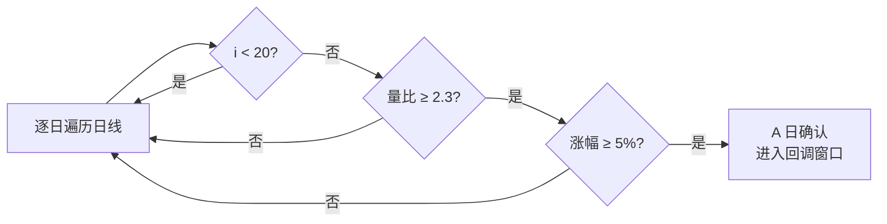
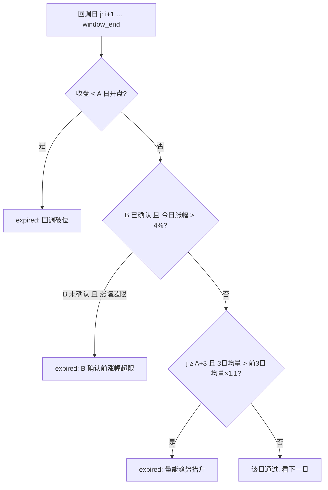
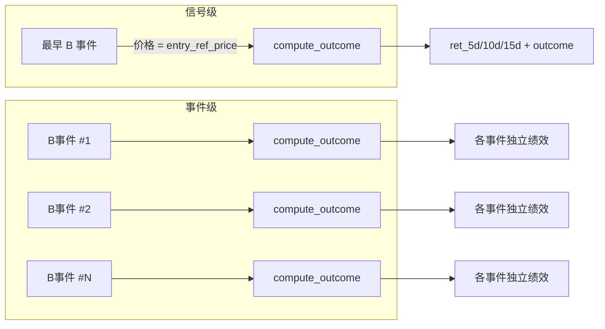
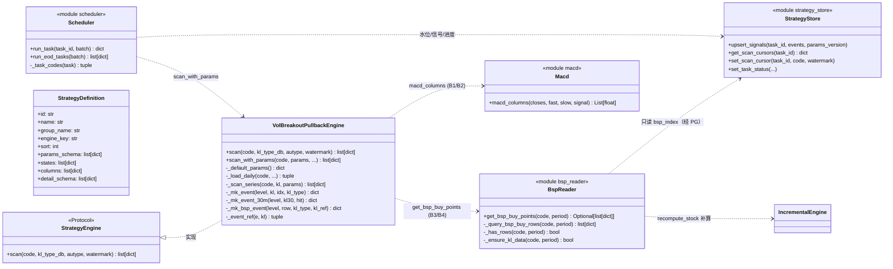
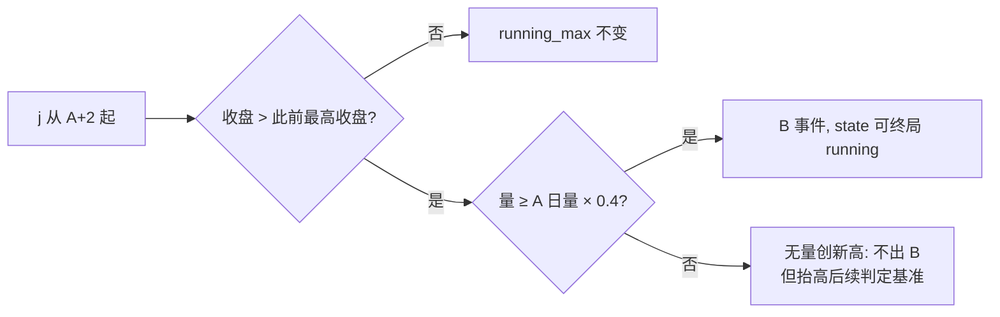
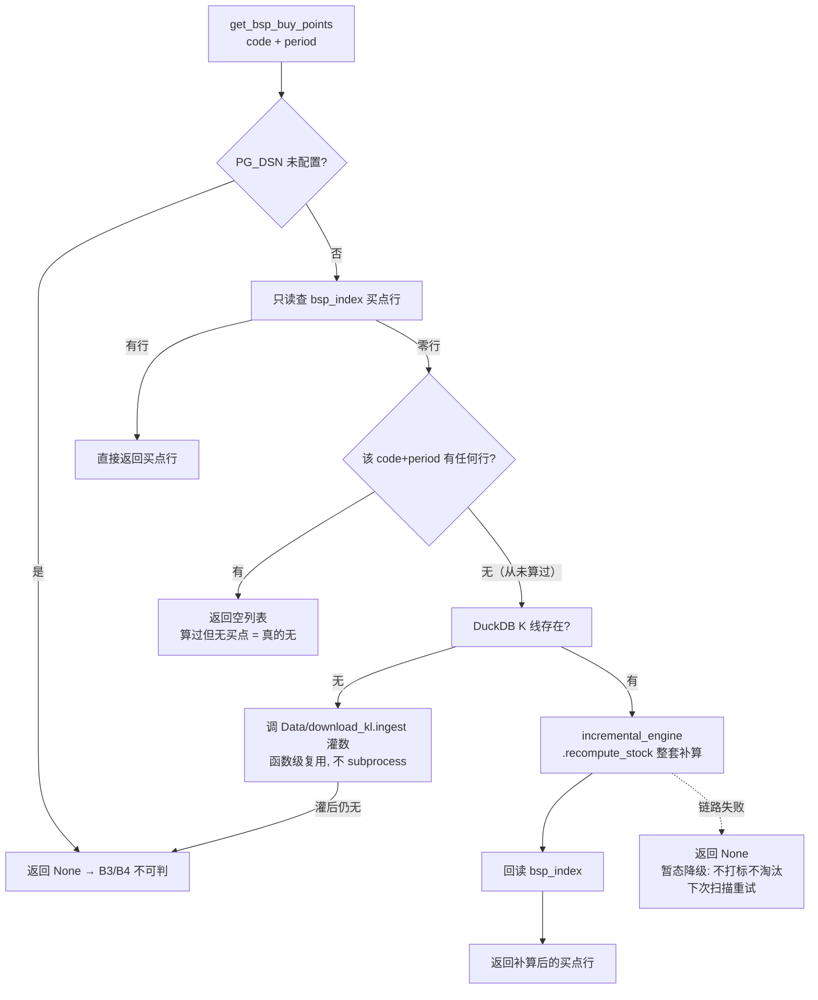
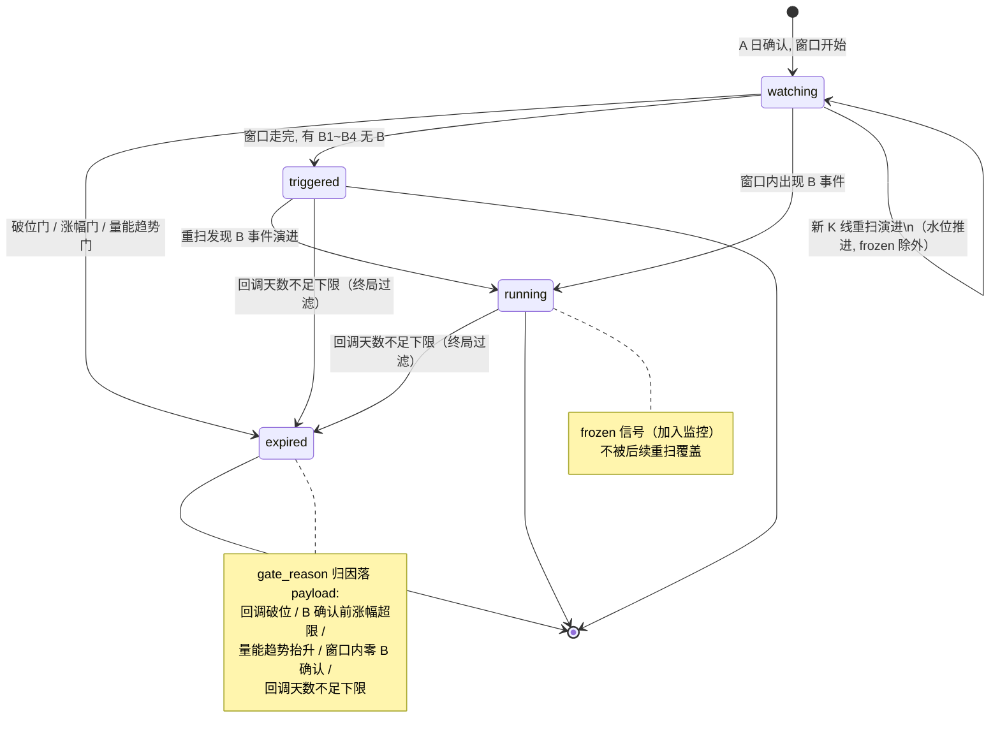
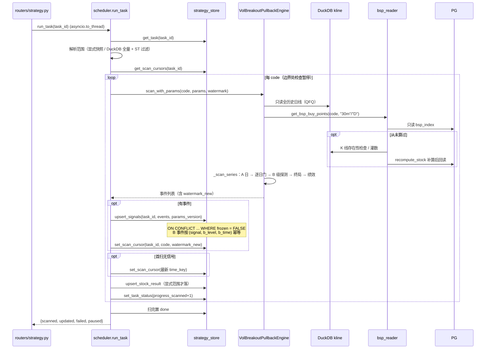

# 放量启动回调策略实现解读

> 本文档解读 `WebAPI/strategy_engines/` 中**放量启动回调**（`vol_breakout_pullback`）策略的实现理论与代码结构，配以 UML 类图、状态图、流程图、时序图。
>
> **维护约定**：后续任何对放量启动回调策略实现的变更（判定规则、参数语义、B 级事件口径、状态机、存储结构等），必须**同步修改本文档**对应章节。

---

## 目录

1. [一句话总览](#1-一句话总览)
2. [策略理论：它想捕捉什么行情](#2-策略理论它想捕捉什么行情)
3. [核心概念逐个解读](#3-核心概念逐个解读)
   - 3.1 A 日（放量启动）
   - 3.2 回调窗口与三道逐日门
   - 3.3 B 点分级判定（B1/B2/B3/B4/B）
   - 3.4 信号状态机
   - 3.5 回调天数与下限过滤
   - 3.6 绩效计算（B 事件独立 + 信号级）
4. [代码结构总览](#4-代码结构总览)
5. [UML 类图](#5-uml-类图)
6. [主扫描流程图](#6-主扫描流程图)
7. [B 级事件探测细节](#7-b-级事件探测细节)
8. [缠论买点间接链路（B3/B4 数据来源）](#8-缠论买点间接链路b3b4-数据来源)
9. [状态图](#9-状态图)
10. [时序图：一次任务扫描](#10-时序图一次任务扫描)
11. [持久化与幂等](#11-持久化与幂等)
12. [参数一览](#12-参数一览)
13. [关键实现细节备忘](#13-关键实现细节备忘)

---

## 1. 一句话总览

放量启动回调策略寻找这样一类形态：**某天巨量急涨（A 日「放量启动」）→ 缩量横盘回调但形态不坏（回调窗口）→ 回调期出现企稳买点（B 级事件）→ 确认后市启动**。它不预测启动本身，而是在启动已经发生之后，**等回调给一个二次上车的位置**。

代码上一个 A 日产出一条信号，信号的生命周期由「三道逐日门淘汰 + 五级 B 点确认 + 窗口终局判定」共同驱动，最终落在 `watching / triggered / running / expired` 四态之一，并给每个 B 级事件独立计算 5/10/15 日绩效。

```
A日(放量+急涨) ──> 回调窗口(≤N交易日) ──> 逐日门(破位/涨幅/量能) ──淘汰──> expired
                        │
                        └──> B级事件探测(B1~B4/B) ──> 窗口走完终局 ──> triggered / running
                                    │
                                    └──> 每个 B 事件独立绩效(5/10/15日)
```

## 2. 策略理论：它想捕捉什么行情

一只股票从横盘突然放量大涨，往往意味着主力资金进场。但追高买在启动日风险大——常见走势是冲高后缩量回调几天，洗掉跟风盘，然后再向上突破。这个策略就是把这个经验形态程式化：

- **A 日**：确认「启动」确实发生（量够大、涨幅够高），不追高，只把它记为观察锚点。
- **回调期**：健康的回调有三个特征——不跌破 A 日开盘价（破位门）、单日不大幅反弹（涨幅门，说明「还没轮到涨」）、量能逐步萎缩而非持续放大（量能趋势门，持续放量 = 主力出货嫌疑）。任一破坏即淘汰。
- **B 级买点**：回调末期用五个独立视角探测企稳——日线 MACD 转多头（B1）、30 分钟 MACD 底背离（B2）、30 分钟缠论买点（B3）、日线缠论买点（B4）、放量突破回调期高点（B 终局）。它们**互不前置**：任何一个视角先看到企稳都算确认。
- **回调天数下限**：最早买点出现太早（距 A 日不足 `pullback_min_days`）说明回调不充分，仍然淘汰。

一句话：**A 日保证「有启动」，逐日门保证「回调健康」，B 级事件回答「何时企稳」，绩效字段回答「这样做赚不赚钱」。**

## 3. 核心概念逐个解读

### 3.1 A 日（放量启动）

**理论**：量价齐升的启动日。两个门槛同时满足：

| 门槛 | 公式 | 默认值 |
|------|------|--------|
| 放量 | 当日成交量 ≥ 前 20 日均量 × `volume_ratio_min` | 2.3 倍 |
| 急涨 | 收盘涨幅（对前一交易日收盘）≥ `a_pct_min` | 5% |

**代码**（[vol_breakout.py](../WebAPI/strategy_engines/vol_breakout.py) `_scan_series` 主循环）：

- 上市不足 20 日的次新股不参与（`i < _VOL_MA_WINDOW` 直接跳过，均量算不出来）。
- 信号日期 `signal_date` = A 日；**相邻 A 日信号不重叠**——命中一个 A 日后，游标直接跳到该回调窗口之后继续找下一个 A 日（`i = window_end + 1`）。



### 3.2 回调窗口与三道逐日门

**理论**：A 日之后观察 `pullback_max_days`（默认 13）个交易日。窗口内逐日施加三道门，**任一触发 → 直接 expired**（不再看后面）：

1. **破位门**（全程适用）：任一回调日**收盘 < A 日开盘价**。A 日开盘价是启动前的最后防线，收盘跌破说明启动失败。
2. **涨幅门**：**尚无任何 B 级事件确认时**，任一回调日收盘涨幅 > `pullback_pct_max`（默认 4%）。回调中不该出现大涨——大涨说明这已经不是回调，策略前提失效。注意：**B 确认日之后涨幅门失效**（B 确认后涨回来是「突破在即」的正常走势），只有破位门与量能趋势门继续适用。
3. **量能趋势门**（A+3 日起）：当日 3 日均量 > 前 3 日均量 × `volume_trend_ratio`（默认 1.1）。允许 ±10% 内的小幅抖动，**量能持续抬升**才淘汰——主力借回调出货的特征。

> 历史：早期版本的「量能峰 P 锚定 + D' 缩量终局判定」已废弃，由量能趋势门以**趋势口径**取代（`volume_shrink_max` 参数已从参数表移除）。

**代码**：三道门在 `_scan_series` 的逐日循环 `for j in range(i+1, window_end+1)` 内联判定，触发即置 `state = "expired"` + `gate_reason` 归因并 `break`。`gate_reason` 落入 payload，供前端展示与调试。



### 3.3 B 点分级判定（B1/B2/B3/B4/B）

**理论**：五个独立的企稳探测器，等级标签仅表达**确认强度** B1 < B2 < B3 < B4 < B，但**互不前置**——不要求低等级先出现。全部只在回调窗口内判定，**不越窗**（窗口结束后的确认不算）。

| 等级 | 名称 | 判定依据 | 数据源 |
|------|------|----------|--------|
| B1 | 初步确认 | 日线 MACD 柱**绿柱绝对值连续 3 根递减**，或柱值**由负转正**（金叉） | 日线收盘 → `macd_columns` |
| B2 | 中部确认 | 30 分钟 MACD **柱面积底背离**：两笔下跌，价创新低而绿柱面积和不创新低 | 30m K 线 → `macd_columns` |
| B3 | 较强确认 | 30 分钟缠论**任意等级买点**（出现即打标，`is_sure` 不作过滤） | PG `bsp_index`（30m） |
| B4 | 强确认 | 日线缠论任意等级买点 | PG `bsp_index`（D） |
| B  | 终局确认 | **放量突破回调期高点**：收盘 > 窗口内此前最高收盘，且量 ≥ A 日量 × `breakout_vol_ratio`（默认 0.4） | 日线 |

几个容易忽略的口径细节：

- **B1 物理最早出现在 A+4**：柱要先有绿柱且要 3 根递减。绿柱「连续 2 根递减」不算（严格 3 根）。
- **B2 需要两笔独立的同向下跌**：相邻局部低点间隔 ≥ 8 个 30m bar 且其间反弹收复第一个低点——只有一段下跌时无从判背离。局部低点取 ±2 bar 邻域最小（去抖动）。
- **B 的「此前最高收盘」初值 = 窗口第一日收盘**，突破判定从 A+2 起（A+1 自身是首个回调日，尚无「此前」高点）。**无量创新高不出 B，但会抬高后续判定的基准**。
- **B3/B4 未确认买点（`is_sure = FALSE`）也算 B 事件**——回顾性重扫会让确认状态自然演进。

**窗口走完的终局**（`window_full` 为真时才可判）：

- 零 B 级事件 → `expired`（当前区间形态无效，`gate_reason = "窗口内零 B 确认"`）；
- 仅有 B1~B4（无 B）→ `triggered`（已触发，等待突破）；
- 事件集合含 B → `running`（已放量启动）。

窗口被数据边界截断时保持 `watching`（终局不可判）。

### 3.4 信号状态机

四个状态（定义见 [strategy_engines/\_\_init\_\_.py](../WebAPI/strategy_engines/__init__.py) 的 `states` 声明）：

| 状态 | 标签 | 含义 |
|------|------|------|
| `watching` | 回调中 | 窗口未走完，逐日门未触发，等待 B 级事件 |
| `triggered` | 已触发 | 窗口走完，有 B1~B4 但无 B（买点出现，尚未放量突破） |
| `running` | 已启动 | 窗口内出现 B（放量突破回调期高点） |
| `expired` | 已失效 | 逐日门触发 / 零 B / 回调天数不足 |

注意 `watching → triggered → running` 不是同一时间轴上的顺序推进——`triggered` 与 `running` 都在窗口走完时一次性终局判定（除非 B 突破事件在窗口中途就出现并随重扫演进）。重扫（新 K 线到来）会让 `watching` 信号向终态演进，但**已 frozen 的行不会被覆盖**（见第 11 节）。

### 3.5 回调天数与下限过滤

**回调天数 = 最早 B 级事件日 − A 日**（按交易日索引差）。注意这是**换锚后的口径**——旧口径「窗口最低收盘日 − A 日」已废弃。

最早 B 事件距 A 日不足 `pullback_min_days`（默认 4）→ `expired`（`gate_reason = "回调天数不足下限"`）。前提是信号已是 `triggered/running`——`watching` 的中间态不做此过滤（B 事件还在演进，天数可能变）。

### 3.6 绩效计算（B 事件独立 + 信号级）

绩效由两策略共用的 `compute_outcome`（[strategy_engines/\_\_init\_\_.py](../WebAPI/strategy_engines/__init__.py)）计算，口径（2026-10-15 修订版）：

- **收益窗口**：入场日后 +5 / +10 / +15 个交易日（`OUTCOME_HORIZONS = (5, 10, 15)`，原 7/14/30 已改）。未来数据不足的时段收益率为 `None`。
- **成功判定**：加权总收益 = `ret_5d×0.3 + ret_10d×0.5 + ret_15d×0.2`；总收益 > 5% → `success`，否则 `failed`；**三时段任一不可得 → `pending`**（不做权重归一化、不按 0 计入）。
- **买入基准价 = 该 B 事件的价格**（B1/B/B4 = 日线收盘，B2 = 30m bar 收盘，B3 = bsp_index.price）。
- **B 事件独立绩效**：每个 B 级事件各自算一套 5/10/15 日收益与 outcome。
- **信号级绩效**：按**最早** B 事件起算（入场日 = 最早 B 事件日，基准价 = 最早事件价格）；信号行的 `entry_ref_price` = 最早 B 事件价格，`stop_ref_price` = A 日最低价（仅匹配态给出，`watching` 态两者为 `None`）。



## 4. 代码结构总览

策略实现位于 `WebAPI/strategy_engines/`（独立于缠论计算内核 `ChanAnalyse/`），涉及的模块分工：

```
WebAPI/strategy_engines/
├── __init__.py            策略定义注册表 + 引擎协议 + validate_params + compute_outcome
├── vol_breakout.py        ★ 放量启动回调引擎（VolBreakoutPullbackEngine，本文档主角）
├── macd.py                MACD 柱序列（12/26/9 EMA，包内独立实现，不 import ChanAnalyse）
├── bsp_reader.py          缠论买点只读读取器（B3/B4 数据来源，含按需补算链路）
├── scheduler.py           扫描调度（run_task / run_eod_tasks，水位推进）
└── vp_entry/              另一策略（量价三段式买点），不在本文档范围
```

支撑设施（引擎外部）：

| 模块 | 职责 |
|------|------|
| `WebAPI/strategy_store.py` | `strategy_task` / `strategy_signal` / `strategy_signal_b_event` / `strategy_scan_cursor` 四张 PG 表的持久化，含 frozen 冻结门 |
| `WebAPI/routers/strategy.py` | 任务 start/resume 等 HTTP 入口（`asyncio.to_thread` 调度） |
| `WebAPI/app.py` | `_strategy_eod_loop` 日终增量扫描 |
| DuckDB `kline` 表 | 原始 K 线（日线 + 30m），引擎只读 |
| PG `bsp_index` 表 | 缠论买点结论（B3/B4 数据源，引擎只读，写入只经增量续算引擎） |

**硬性约束**（引擎协议）：`vol_breakout.py` 不 import CChan 任何计算模块——MACD 用包内 `macd.py`，缠论买点经 `bsp_reader` 间接链路（只读 PG + 按需调增量续算引擎补算）。

## 5. UML 类图



模块级函数（不属于引擎类，`_scan_series` 直接调用）：

| 函数 | 职责 |
|------|------|
| `_load_30m_kl(code)` | 读 30m K 线（B2 用），失败返回空表 = B2 不可判（暂态降级，不淘汰信号） |
| `_detect_b1(kl, i, window_end, cols)` | 日线 MACD 绿柱递减 / 金叉，返回首个命中日索引 |
| `_detect_b2(kl30, window_days)` | 30m 柱面积底背离，返回 (确认 bar 时间, 收盘价) |
| `_detect_b34(bsp_rows, kl, i, window_end)` | bsp 行 → 窗口内买点事件列表 |
| `_detect_b(kl, i, window_end, ratio)` | 放量突破，返回首个突破日索引 |

## 6. 主扫描流程图

`scan` / `scan_with_params` 是两条等价入口（后者带任务实例参数，旧任务 params 缺新键时合并默认值）。核心在 `_scan_series`（纯函数：日线序列 + 参数 → 事件列表，便于 Debug 冒烟脚本直测）：

```mermaid
flowchart TD
    S0[scan / scan_with_params] --> S1[_load_daily\n读全历史日线 QFQ]
    S1 --> S2{watermark 非空 且\n无新 K 线?}
    S2 -->|是| S3[返回 空列表\n调度方不推进水位]
    S2 -->|否| S4[_scan_series]
    S4 --> S5[事件附 watermark_new\n返回]

    subgraph _scan_series 主循环
        L0[游标 i 逐日前进] --> L1{A 日判定\n量比≥2.3 且 涨幅≥5%}
        L1 -->|否| L0
        L1 -->|是| L2[锚定 A 日\nwindow_end = min&#40;i+13, n-1&#41;]
        L2 --> L3[懒加载一次\n30m K 线 + 30m/D 缠论买点]
        L3 --> L4[全序列日线 MACD 柱\nB1/B2/B3/B4/B 五路独立探测]
        L4 --> L5[b_events 按时间排序\nfirst_b_day = 最早事件日]
        L5 --> L6[逐日门循环\n破位/涨幅/量能趋势]
        L6 -->|任一门触发| X[state = expired\ngate_reason 归因]
        L6 -->|全部通过| L7{窗口走完?}
        L7 -->|否| W[state = watching]
        L7 -->|是| L8{B 级事件数}
        L8 -->|0| X2[expired: 零 B 确认]
        L8 -->|含 B| R[state = running]
        L8 -->|仅 B1~B4| T[state = triggered]
        X --> F
        X2 --> F
        R --> F{回调天数 ≥ 下限?}
        T --> F
        W --> F2[watching 直落库\n不出入场/止损价]
        F -->|不足| X3[expired: 回调天数不足]
        F -->|足够| P[匹配态:\n止损=A日最低价\n绩效按最早 B 事件]
        X3 --> Z[产出一条 SignalEvent\n游标 i = window_end + 1]
        P --> Z
        F2 --> Z
        Z -->|还有后续数据| L0
    end
```



要点：

- **信号不重叠**：命中 A 日后游标跳过整个窗口，前一个信号的窗口尚未走完时又出现的新 A 日不产生信号。
- **B 级探测发生在逐日门之前**（一次性算好窗口内全部事件），但涨幅门判定需要 `first_b_day` 做「B 确认前/后」分界——这是探测与门之间的唯一耦合点。

## 7. B 级事件探测细节

### 7.1 B1：日线 MACD 转多头

```mermaid
flowchart LR
    A[窗口内逐日 j] --> B{柱由负/零转正?}
    B -->|是| H[金叉 → B1]
    B -->|否| C{j ≥ A+3? 且 当前及前2根均为绿柱?}
    C -->|是| D{|柱| 连续3根递减?}
    D -->|是| H2[绿柱收缩 → B1]
    D -->|否| A
    C -->|否| A
```

`cols` 为全序列 MACD 柱（`macd_columns` 一次算完，EMA 递推与 `ChanAnalyse.Math.MACD.CMACD` 同口径：首值 EMA = 首价、DIF/DEA 从 0 起）。

### 7.2 B2：30m MACD 柱面积底背离

```mermaid
flowchart TD
    A[取窗口日内全部 30m bar] --> B[全 30m 序列算 MACD 柱]
    B --> C[局部低点 = ±2 bar 邻域最小收盘]
    C --> D[按确认时间遍历低点对 k1, k2]
    D --> E{k2 - k1 ≥ 8 bar?}
    E -->|否| D
    E -->|是| F{其间反弹收复 k1\nmid_max > closes&#91;k1&#93;?}
    F -->|否| D
    F -->|是| G{k2 为 k1..k2 区间真正最低?}
    G -->|否| D
    G -->|是| H[取两段下跌<br/>反弹高点→k1 与 中间高点→k2]
    H --> I[area = 段内 MACD 绿柱绝对值之和]
    I --> J{area2 < area1<br/>且两面积均 > 0?}
    J -->|是| K[B2 = k2 bar 时间 + 收盘价]
    J -->|否| D
```



锚定细节（design D2）：相邻低点间隔 ≥ 8 bar 保证两段独立下跌非同一波段；反弹收复 k1 排除一路阴跌；k2 须为区间最低排除越窗前的伪新低。30m 数据不可得（`_load_30m_kl` 失败/空）时 B2 不可判——**不打标、不淘汰**（D5 暂态降级），B1/B4/B 仍可独立使信号成立。

### 7.3 B：放量突破回调期高点



### 7.4 B 事件结构

每个 B 事件是统一结构的 dict（落库到 `strategy_signal_b_event`）：

```json
{
  "b_level": "B2",            // B1/B2/B3/B4/B
  "b_time": "2025-07-23 10:00:00",  // 30m 事件带时刻；日线事件为 "YYYY-MM-DD 00:00:00"
  "b_kl_type": "30m",         // "D" / "30m"
  "price": 23.95,             // 绩效基准价
  "open": null,               // 日线事件带开盘价
  "day_pct": -0.012,          // 当根涨幅（30m 事件 = bar 涨幅）
  "bsp_type": "BS1",          // 仅 B3/B4：缠论买点类型
  "is_sure": true,            // 仅 B3/B4
  "ret_5d": ..., "ret_10d": ..., "ret_15d": ...,   // 独立绩效（匹配态才填）
  "outcome": "success"
}
```

## 8. 缠论买点间接链路（B3/B4 数据来源）

引擎**只读** PG `bsp_index`，不 import 缠论计算内核。数据不存在时走「按需补算」强语义链路（[bsp_reader.py](../WebAPI/strategy_engines/bsp_reader.py)）：



量级控制：补算只在「PG 无该 (code, period) 行」时触发（`recompute_stock` 是幂等整套替换，重复触发无意义）；全量任务首扫会集中触发一次，属一次性成本。

## 9. 状态图

信号状态机（`_scan_series` 终局判定 + 重扫演进视角）：



## 10. 时序图：一次任务扫描

调度入口 `scheduler.run_task`（用户 start/resume 或 EOD 日终循环）到引擎、存储的完整协作：



EOD 调度（`run_eod_tasks`）只取 `mode='persistent'` 的任务做增量扫描；`running` 状态的任务本轮跳过（避免与用户触发的执行器竞争）。

## 11. 持久化与幂等

**水位语义**：`strategy_scan_cursor` 表按 `(task_id, code)` 存 watermark（DuckDB `time_key` 字符串）。scan 时 watermark 非空且其后无新 K 线 → 返回空列表，不重算、不推进水位；有新 K 线 → 全历史重算（量价窗口需要历史上下文），事件附带 `watermark_new` 由调度方推进。

**幂等 upsert**：引擎每次都读全历史重算信号全集，但 `strategy_store.upsert_signals` 走唯一键 upsert——重复扫描不产生重复信号。两个关键保护：

- `strategy_signal` 的 upsert 带 `WHERE strategy_signal.frozen = FALSE`：**已加入监控（frozen）的信号不被重扫覆盖**，其 B 事件与绩效冻结不变。
- `strategy_signal_b_event`（B 事件子表）按 `(signal, b_level, b_time)` 冲突时更新绩效——重扫补数据不重复插行；frozen 信号的 B 事件整体跳过。

**逐股结果分叉**：显式范围任务每 code 落 `strategy_task_stock_result` 行（含未匹配与失败）；`'all'` 范围只推进聚合计数不落逐股结果（存储量约束）。

**单键失败不中断**：逐 code try/except，失败计数 + 摘要 + 显式范围落 failed 行，继续下一只。

## 12. 参数一览

`params_schema` 声明（`validate_params` 校验：未知键报错、类型/最小/最大校验，enum 走独立分支）：

| key | 标签 | 类型 | 默认 | 范围 | 含义 |
|-----|------|------|------|------|------|
| `pullback_max_days` | 回调天数上限 | int | 13 | 1~20 | A 日后最多观察的交易日数，窗口走完零 B 判失效 |
| `pullback_min_days` | 回调天数下限 | int | 4 | 0~19 | 最早 B 事件距 A 日的下限，不足判回调不充分 |
| `volume_ratio_min` | 启动放量倍数下限 | float | 2.3 | 1.0~10.0 | A 日量 / 前 20 日均量的下限 |
| `a_pct_min` | 启动日涨幅门槛 | float | 0.05 | 0.03~0.15 | A 日收盘涨幅下限 |
| `pullback_pct_max` | 回调涨幅门阈值 | float | 0.04 | 0.02~0.10 | B 确认前回调期单日涨幅上限 |
| `volume_trend_ratio` | 量能趋势门倍数 | float | 1.1 | 1.05~2.0 | A+3 起当日 3 日均量相对前 3 日均量的上限倍数 |
| `breakout_vol_ratio` | 突破量比 | float | 0.4 | 0.2~1.0 | B 终局突破日的量 / A 日量下限 |

非参数的定死口径：均量窗口 20 日、B1 绿柱递减根数 3、B2 低点间隔 8 bar / 反弹 4 bar、绩效窗口 5/10/15 日、绩效权重 0.3/0.5/0.2、成功阈值 5%——均以常量写死在代码中，不做参数。

## 13. 关键实现细节备忘

1. **不触碰缠论内核**：引擎只依赖 `KLineStore`（DuckDB 读）+ 包内 `macd.py` + `bsp_reader`（只读 PG）。`macd.py` 存在的理由是 ChanAnalyse.Math.MACD 虽无依赖但属 ChanAnalyse 包成员，import 它会破协议字面。
2. **`_scan_series` 是纯函数**：`(code, kl 序列, params) → 事件列表`，不碰 PG/DuckDB（30m/bsp 数据在函数外懒加载一次传入）——Debug 冒烟脚本可内存构造 K 线直测判定逻辑（见 `Debug/strategy_task_smoke.py`、`Debug/strategy_outcome_smoke.py`）。
3. **涨幅门与 B 探测的耦合**：B 级探测先于逐日门完成，`first_b_day`（最早 B 事件日）作为涨幅门「B 确认前/后」的分界；B 确认后涨幅超限不再淘汰（涨回来 = 突破在即）。
4. **`_detect_b` 的基准演进**：无量创新高不出 B 但抬高 `running_max`——后续突破必须超过被抬高的基准，防止「先缩量创新高、再放量小涨」被误判为突破。
5. **30m 事件折算**：`_event_ref` 把 30m B 事件的绩效参照折算到所属交易日的日线索引（价格仍用事件自身价格），统一进 `compute_outcome` 的日线坐标系。
6. **降级语义**（D5）：30m K 线读失败（B2 不可判）、bsp 补算链路失败（B3/B4 不可判）、PG 未配置——统统返回 `None`/空集，**不打标、不报错、不淘汰信号**，日志记录原因，下次扫描重试。
7. **`watermark_new` 附着在事件上**：引擎不直接写游标（`strategy_scan_cursor` 由调度方推进），首扫无信号的 code 由调度方查 `_latest_time_key` 补推进，否则每个调度周期都重扫全历史。
8. **`is_sure` 不过滤**：缠论买点出现即打标（回顾性判定下重扫自然演进），frozen 行的 B 事件不受演进影响。
9. **冻结边界**：`upsert_signals` 的 `ON CONFLICT ... WHERE frozen = FALSE` 是「加监控 = 冻结快照」语义的实现基石——用户把信号加入监控后，后续新数据不再改变该信号的 B 事件与绩效。
