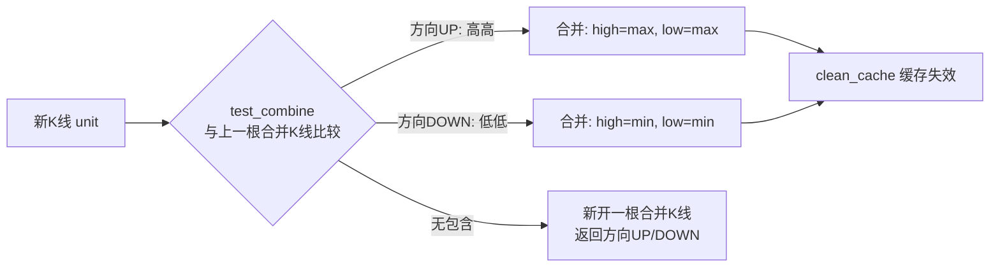
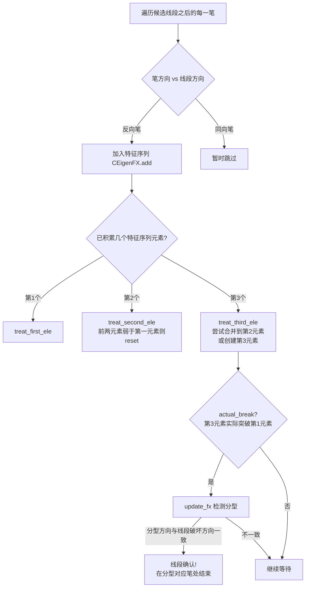
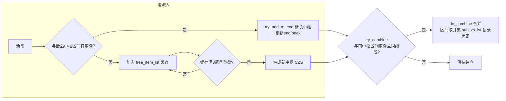
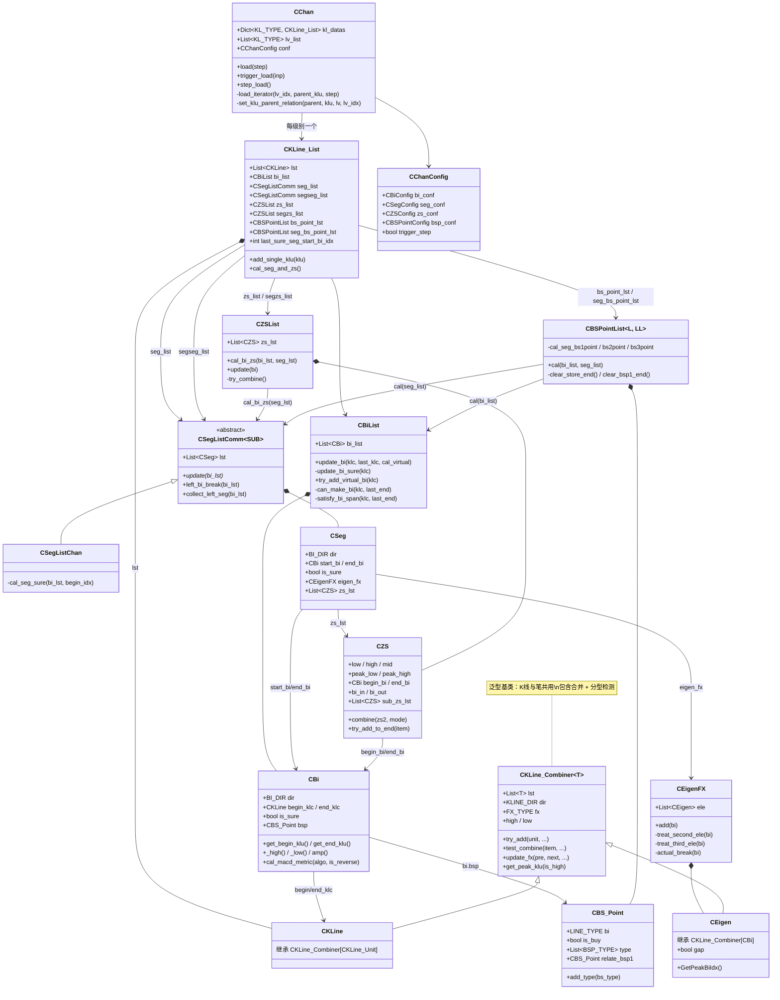
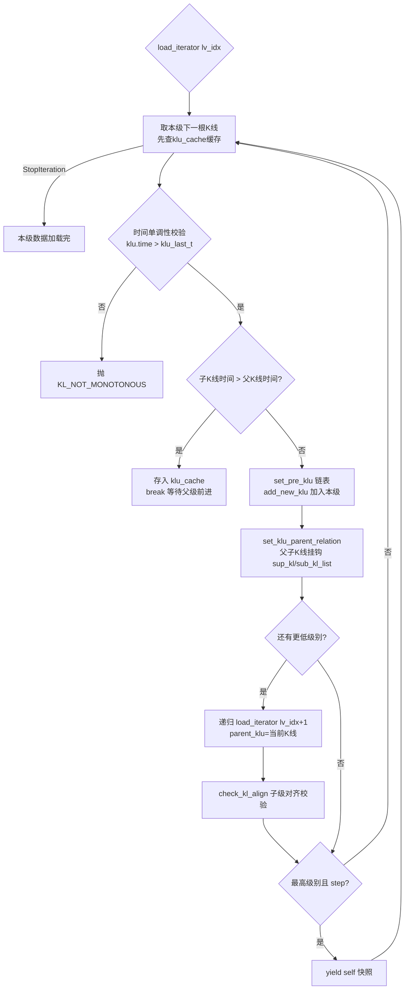
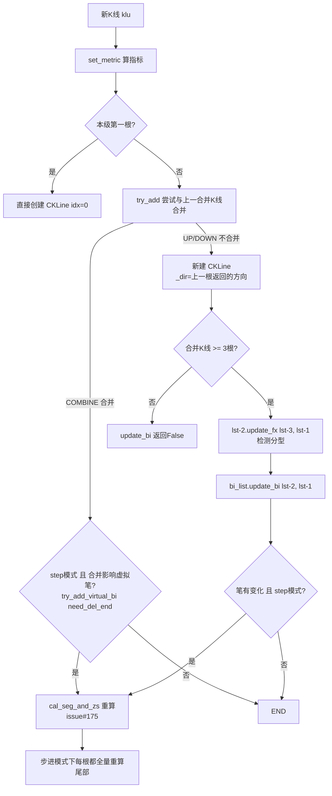
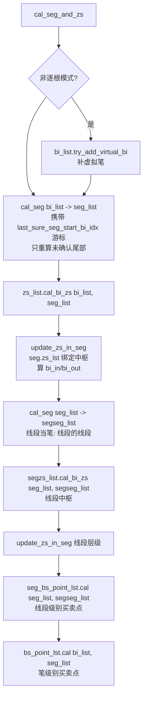
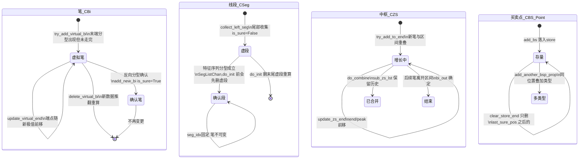
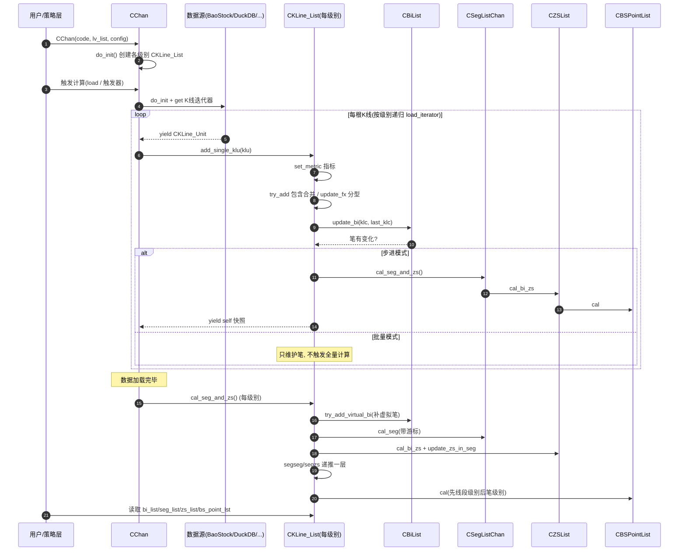

# 缠论策略实现解读

> 本文档解读 `ChanAnalyse/` 中缠论计算内核的**理论内容与代码实现**，配以 UML 类图、流程图、状态图、时序图。
>
> **维护约定**：后续任何对缠论理论实现的变更（笔/线段/中枢/买卖点的算法、规则、配置语义变化），必须**同步修改本文档**对应章节。

---

## 目录

1. [一句话总览](#1-一句话总览)
2. [计算流水线全景图](#2-计算流水线全景图)
3. [核心概念逐个解读](#3-核心概念逐个解读)
   - 3.1 K 线包含处理（合并 K 线）
   - 3.2 分型（顶分型 / 底分型）
   - 3.3 笔
   - 3.4 线段（特征序列法）
   - 3.5 中枢
   - 3.6 买卖点
   - 3.7 背驰与指标
4. [UML 类图](#4-uml-类图)
5. [数据加载流程（多级别递归）](#5-数据加载流程多级别递归)
6. [单根 K 线处理流程](#6-单根-k-线处理流程)
7. [cal_seg_and_zs：从笔到买卖点的计算顺序](#7-cal_seg_and_zs从笔到买卖点的计算顺序)
8. [状态图：确认与虚拟元素](#8-状态图确认与虚拟元素)
9. [时序图：批量模式主流程](#9-时序图批量模式主流程)
10. [两种运行模式](#10-两种运行模式)
11. [配置系统](#11-配置系统)
12. [关键实现细节备忘](#12-关键实现细节备忘)

---

## 1. 一句话总览

系统把一串原始 K 线，按「**合并 → 分型 → 笔 → 线段 → 中枢 → 买卖点**」的顺序逐层抽象：

```
原始K线 ──包含处理──> 合并K线 ──分型检测──> 顶/底分型 ──成笔──> 笔 ──特征序列──> 线段
                                                                    │
                                                                    v
              买卖点 <── 背驰判断 <── 中枢(由至少3笔重叠区间构成) <──+
```

每往上一层，元素数量变少、语义变重：几根 K 线合成一根合并 K 线，几个分型合成一笔，几笔合成一段，几段重叠构成中枢，中枢背驰产生买卖点。买卖点是最终输出，也是策略层（WebAPI / 前端 / 回测）消费的唯一结论。

## 2. 计算流水线全景图

```mermaid
flowchart TD
    A[数据源 DataAPI\nBaoStock/Akshare/CCXT/CSV/DuckDB/Minute] -->|逐根 yield CKLine_Unit| B[CChan.load_iterator\n多级别递归加载]
    B --> C[CKLine_List.add_single_klu\n逐根K线处理]
    C --> C1[指标计算\nMACD/BOLL/RSI/KDJ/DeMark]
    C1 --> C2[CKLine_Combiner.try_add\n包含关系合并]
    C2 -->|不合并| C3[CKLine.update_fx\n分型检测]
    C3 --> C4[CBiList.update_bi\n笔更新]
    C4 -->|笔有变化| D[cal_seg_and_zs]
    C2 -->|合并且影响虚拟笔| D
    D --> D1[CSegListChan.update\n线段: 特征序列分形]
    D1 --> D2[CZSList.cal_bi_zs\n中枢构建]
    D2 --> D3[update_zs_in_seg\n中枢-线段关联]
    D3 --> D4[线段的线段 segseg\n+ 线段中枢 segzs]
    D4 --> D5[CBSPointList.cal\n买卖点计算]
    D5 --> E[结果访问\nchan&#91;KL_TYPE&#93;.bi_list / seg_list / zs_list / bs_point_lst]
```



关键点：**前面所有步骤都是增量可重算的**——`cal_seg_and_zs` 用 `last_sure_seg_start_bi_idx` 等游标只重算「未确认的尾部」，确认过的前缀不动，这是步进模式和增量续算的根基。

## 3. 核心概念逐个解读

### 3.1 K 线包含处理（合并 K 线）

**理论**：缠论要求相邻 K 线之间不能存在包含关系（一根的高低点完全覆盖另一根），否则分型无法唯一定义。处理办法是把有包含关系的 K 线**合并成一根**。

**代码**（[KLine_Combiner.py](../ChanAnalyse/Combiner/KLine_Combiner.py) 的 `try_add` / `test_combine`）：



- 上升趋势（`dir==UP`）：合并取「高高」——高点取两者最大，低点也取两者最大（向上抬）。
- 下降趋势（`dir==DOWN`）：合并取「低低」——高点取最小，低点取最小（向下压）。
- 合并后的 K 线（`CKLine`，即 `CKLine_Combiner` 实例）持有原始 K 线列表 `lst`，并缓存 high/low；每次合并后 `clean_cache()` 让派生属性重算。
- 一字 K 线（high==low）不改变高低点，避免一字板污染合并方向。

### 3.2 分型（顶分型 / 底分型）

**理论**：三根（合并后）K 线，中间那根高点最高、低点也最高 → **顶分型**；中间低点最低、高点也最低 → **底分型**。顶分型预示向上动能衰竭，底分型反之。

**代码**（`CKLine_Combiner.update_fx`，由 [KLine_List.py](../ChanAnalyse/KLine/KLine_List.py) `add_single_klu` 在新合并 K 线产生后调用 `lst[-2].update_fx(lst[-3], lst[-1])`）：

```
顶分型: pre.high < self.high  且  next.high < self.high
        pre.low  < self.low   且  next.low  < self.low
底分型: 全部反向
```

注意 `update_fx` 有两套判断：普通 K 线分型（上述四条件严格版），和 `exclude_included=True` 的**特征序列分型**（用于虚段，条件略宽，配合 `allow_top_equal` 处理相等边界）。

### 3.3 笔

**理论**：相邻的顶分型与底分型连成一笔。笔必须满足最小长度（通常顶底间至少 5 根 K 线 / 3 根合并 K 线）且分型有效（不能共用 K 线等）。笔是缠论最基本的走势单元，后续一切结构都建立在笔上。

**代码**（[BiList.py](../ChanAnalyse/Bi/BiList.py) `CBiList.update_bi` → `update_bi_sure` / `try_add_virtual_bi`）：

- `can_make_bi` 检查三个条件：K 线跨度（`satisfy_bi_span`，bi_algo='fx' 时跳过）、分型有效性（`check_fx_valid`，分型间不能重叠共用）、端点是极值（`bi_end_is_peak`）。
- 笔的方向由起始分型决定（[Bi.py](../ChanAnalyse/Bi/Bi.py) `set`）：底分型开头 → 上升笔，顶分型开头 → 下降笔。
- **第一笔**特殊（`try_create_first_bi`）：之前没有确定分型，用 `free_klc_lst` 缓存历史分型 K 线，直到出现反向分型且满足成笔条件。
- **虚拟笔**（`try_add_virtual_bi`）：最后一笔往往还没走完——末端分型已出现但反向笔未确认。系统先挂一条"虚拟笔"参与后续计算（线段/中枢/买卖点都能用它），等真正确认后再转正或重算。批量模式在全部 K 线加载完后补一次虚拟笔。
- **次高点/次低点优化**（`can_update_peak` / `update_peak`）：笔端点不是精确极值时允许用次高点替换，前提是不使笔方向反转、不使前后笔重叠。

### 3.4 线段（特征序列法）

**理论**：线段由至少 3 笔构成，且被反向线段破坏才算结束。判断线段结束的标准工具是**特征序列**：上升线段中所有**下降笔**视为"K 线"组成特征序列；特征序列出现**顶分型** → 线段被破坏，线段在该分型处结束。

**代码**（[SegListChan.py](../ChanAnalyse/Seg/SegListChan.py) `cal_seg_sure` + [EigenFX.py](../ChanAnalyse/Seg/EigenFX.py) `CEigenFX` + [Eigen.py](../ChanAnalyse/Seg/Eigen.py) `CEigen`）：



- `CEigen` 继承 `CKLine_Combiner[CBi]`——**把笔当 K 线做包含合并**，合并规则与 K 线完全相同（这是缠论"递归自相似"的直接体现）。
- **跳空缺口**（`CEigen.gap`）：特征序列分型第 1、2 元素间有跳空 → 属于线段破坏第二种情况，需等待反向特征序列再确认。
- 分型对应结束笔：`GetPeakBiIdx` 返回 `峰值笔.idx - 1`（分型前一笔才是线段结束笔）。
- 尾部未确认部分由 `collect_left_seg` 收成**虚段**（`is_sure=False`），左段处理方法 `left_seg_method=peak` 时找极值点作第一条线段。
- 三种算法均继承 `CSegListComm`：`chan`（默认，特征序列法）、`1+1`（SegListDYH，已弃用）、`break`（SegListDef，已弃用）。

### 3.5 中枢

**理论**：中枢是至少 3 笔（段）的价格重叠区间，代表多空拉锯的"价值区域"。中枢区间 `[low, high] = [max(各笔低点), min(各笔高点)]`，只有重叠才存在。中枢的进入笔（bi_in）、离开笔（bi_out）、极值（peak_high/peak_low）是买卖点判断的关键锚点。

**代码**（[ZS.py](../ChanAnalyse/ZS/ZS.py) `CZS` + [ZSList.py](../ChanAnalyse/ZS/ZSList.py) `CZSList.cal_bi_zs`）：



- 三种 `zs_algo`：`normal`（按线段切分，每段内找中枢）、`over_seg`（跨线段）、`auto`（确认段用 normal、未确认尾部用 over_seg）。
- 中枢合并条件（`combine`）：不能是一笔中枢、必须在同一线段内、区间按 `zs_combine_mode`（`zs` 看中枢区间 / `peak` 看极值区间）有重叠。
- 中枢与线段互相绑定：`update_zs_in_seg` 把中枢挂到所属线段（`seg.zs_lst`），并计算 bi_in/bi_out。
- **同一套 CZSList/CZS 同时用于两个层级**：笔中枢（`zs_list`，由笔构成）和线段中枢（`segzs_list`，由线段当"笔"构成）——又是递归复用。

### 3.6 买卖点

**理论**：缠论的买卖点体系建立在"中枢 + 背驰"之上。系统实现 6 类（买卖对称）：

| 类型 | 名称 | 通俗解释 | 代码锚点 |
|------|------|----------|----------|
| **T1** | 第一类买卖点 | 趋势背驰点：离开中枢的笔比进入笔力度弱（背驰），趋势衰竭，反转 | `cal_seg_bs1point` |
| **T1P** | 盘整背驰点 | 无中枢（或单中枢盘整）情况下的背驰点 | `cal_seg_bs1point` |
| **T2** | 第二类买卖点 | 一买后回调不创新低（回测不破），确认反转 | `cal_seg_bs2point` |
| **T2S** | 类二买卖点 | 中枢内的多次回测，二买的"次级"版本 | `cal_seg_bs2point` |
| **T3A** | 第三类买卖点(后) | 突破中枢后的回抽不回到中枢内 → 趋势延续 | `treat_bsp3_after` |
| **T3B** | 第三类买卖点(前) | 盘整背驰后同线段内的类三买 | `treat_bsp3_before` |

**代码**（[BSPointList.py](../ChanAnalyse/BuySellPoint/BSPointList.py) `CBSPointList.cal`）：

- 计算顺序：清理失效尾部 → T1/T1P → T2/T2S → T3A/T3B → 更新 `last_sure_pos` 游标。
- 一个位置可同时是多种类型（`CBS_Point.add_type`，如同时 T1+T1P）。
- 跟随关系可配：`bsp2_follow_1`（二买必须跟在一买后）、`bsp3_follow_1`（三买必须跟在一买后）、`bsp2s_follow_2`。
- 三买成立的核心判据（`bsp3_back2zs` / `bsp3_break_zspeak`）：回测笔不回到中枢区间内、且未突破中枢极值。
- **两个层级**：`bs_point_lst`（笔级别买卖点，基于笔+线段）与 `seg_bs_point_lst`（线段级别买卖点，基于线段+线段的线段），绘图时线段级别加 `※` 前缀。
- 买卖点计算完会反向挂到笔上（`bi.bsp = self`），下游通过 `bsp_iter()` 遍历。

### 3.7 背驰与指标

**理论**：背驰 = 价格创新高/新低，但动能（指标）没有同步创新高/新低。判断"笔的力度"是第一类买卖点的核心。

**代码**（[Bi.py](../ChanAnalyse/Bi/Bi.py) `cal_macd_metric`，[BSPointConfig.py](../ChanAnalyse/BuySellPoint/BSPointConfig.py) `divergence_rate`）：

`macd_algo` 支持 12 种力度算法：`area`（MACD 半面积，默认）、`full_area`（全面积）、`peak`（柱峰值）、`diff`、`slope`（斜率）、`amp`（振幅）、`amount`/`volumn`（成交额/量）、`*_avg`（均值版）、`turnrate_avg`（换手率）、`rsi`。

背驰判定：进入笔力度 × `divergence_rate`（默认 0.9） > 离开笔力度 → 判定背驰成立。

所有指标均为**手写实现**（[Math/](../ChanAnalyse/Math/)：MACD/RSI/BOLL/KDJ/DeMark/TrendLine/TrendModel），不依赖 talib；每根 K 线到来时先 `set_metric` 算好，笔级别计算直接取用。

## 4. UML 类图



结构上的三个"复用技巧"：
1. `CKLine_Combiner` 泛型基类：K 线包含合并与笔（特征序列）包含合并共用一套逻辑。
2. `CSegListComm` 同时实例化两次：笔→线段、线段→线段的线段（segseg）。
3. `CZSList`/`CBSPointList` 同样双实例：笔级别 + 线段级别。

## 5. 数据加载流程（多级别递归）

`CChan.load_iterator`（[Chan.py](../ChanAnalyse/Chan.py)）从最高级别向最低级别递归，用**时间对齐**决定父子归属：



- 默认级别组合 `[K_DAY, K_60M]`（日线+60 分钟），可自定义多级别。
- 父子指针（`sup_kl`/`sub_kl_list`）支撑**区间套**策略：在父级别买卖点处下钻看子级别确认。
- 时间语义：天以下级别 K 线时间戳是**结束时间**（60M 每天第一根是 10:30），天以上是当天日期。

## 6. 单根 K 线处理流程

`CKLine_List.add_single_klu` 是整个系统的**核心入口**（[KLine_List.py](../ChanAnalyse/KLine/KLine_List.py:226)）：



两个触发 `cal_seg_and_zs` 的条件（注释中的"条件A/条件B"）：新笔形成（A）、包含处理扰动了虚拟笔（B，issue#175 修复）。

## 7. cal_seg_and_zs：从笔到买卖点的计算顺序

[cal_seg_and_zs](../ChanAnalyse/KLine/KLine_List.py:186) 定义了严格的依赖顺序（**底层 → 高层**）：



顺序不可颠倒：有线段才能有中枢，有中枢才能有买卖点；线段级别买卖点先算（笔级别的二/三买要引用"是否有一买"等上下文）。

## 8. 状态图：确认与虚拟元素

缠论计算的精髓是「**确认 vs 未确认**」——历史结论不可变，尾部结论可被新数据推翻：



游标机制（增量的关键）：
- `CKLine_List.last_sure_seg_start_bi_idx` — 最后确认线段起始笔索引，段计算只从此重算。
- `CZSList.last_sure_pos / last_seg_idx` — 中枢重算起点。
- `CBSPointList.last_sure_pos / last_sure_seg_idx` — 买卖点重算起点（删尾部失效点）。

## 9. 时序图：批量模式主流程



## 10. 两种运行模式

| | 批量模式 `trigger_step=False` | 步进模式 `trigger_step=True` |
|---|---|---|
| 数据加载 | 一次加载全部 | `CChan` 变生成器，每根 K 线 yield 一个快照 |
| 计算时机 | 全部加载完后 `cal_seg_and_zs` 一次 | 每根 K 线都重算段/中枢/买卖点（尾部增量） |
| 用途 | 日常离线分析、绘图 | 回测、动画播放、增量续算 |
| 入口 | `CChan(...)` 直接算完 | `for snapshot in chan.step_load()` |
| 外部推送 | — | `trigger_load(inp)` 追加新 K 线 `{级别: [klu]}` |

步进模式是 WebAPI 增量续算引擎与策略回测的基底：`trigger_load` 往已加载实例追加数据，`cal_seg_and_zs` 靠游标只重算未确认尾部。`skip_step` 可跳过前 N 步。

## 11. 配置系统

`CChanConfig`（[ChanConfig.py](../ChanAnalyse/ChanConfig.py)）接收字典，组装子配置；`ConfigWithCheck` 包装器**消费 key 并对未知 key 抛异常**（严格校验）。

| 配置组 | 关键参数 | 默认 | 语义 |
|---|---|---|---|
| 笔 | `bi_algo` | `normal` | `normal`=标准笔（跨度和分型校验），`fx`=分型笔（跳过跨度检查） |
| | `bi_strict` | `True` | 严格分型 K 线数校验 |
| | `bi_fx_check` | `strict` | 分型间有效性检查严格度 |
| | `gap_as_kl` | `False` | 跳空缺口算 1 根 K 线（放宽成笔） |
| | `bi_end_is_peak` / `bi_allow_sub_peak` | `True`/`True` | 端点极值校验 / 次高次低点允许 |
| 线段 | `seg_algo` | `chan` | `chan`/`1+1`/`break`（后两者已弃用） |
| | `left_seg_method` | `peak` | 首段无分型可依时的处理（峰值法/均值法） |
| 中枢 | `zs_combine` | `True` | 相邻中枢是否合并 |
| | `zs_combine_mode` | `zs` | `zs` 按区间重叠 / `peak` 按极值重叠 |
| | `one_bi_zs` | `False` | 允许一笔中枢 |
| | `zs_algo` | `normal` | `normal`/`over_seg`/`auto` |
| 买卖点 | `divergence_rate` | 0.9 | 背驰判定阈值（进入笔力度×rate vs 离开笔力度） |
| | `bs_type`(买/卖) | `"1,2,3a,1p"` | 目标买卖点类型集 |
| | `macd_algo` | `area` | 12 种力度算法 |
| | `bsp2_follow_1` 等 | 见配置 | 类型间跟随关系 |
| 模式 | `trigger_step` / `skip_step` | `False`/`0` | 步进模式开关 |
| 指标 | `macd` / `cal_rsi` / `cal_kdj` / `boll_n` / `cal_demark` | — | 指标开关与参数 |
| 校验 | `kl_data_check` / `max_kl_misalgin_cnt` 等 | — | 数据质量校验 |

支持按买卖点类型覆盖：`bs_type-buy`/`bs_type-sell`/`seg-` 等后缀实现同一参数在买/卖/线段级别取不同值。

## 12. 关键实现细节备忘

- **实例级缓存**（[Common/cache.py](../ChanAnalyse/Common/cache.py) `@make_cache`）：缓存绑定 `self._memoize_cache`（区别于 `lru_cache` 的全局缓存）。`CBi`/`CKLine_Combiner`/`CZS` 的派生属性（`get_end_klu`/`_high`/`amp` 等）大量使用；**任何状态变更后必须 `clean_cache()`**，否则读到脏值。
- **双向链表**：合并 K 线之间（`pre/next`）、笔之间（`pre/next`）、原始 K 线之间（`pre`）都有链表指针。
- **deepcopy 陷阱**（[Chan.py](../ChanAnalyse/Chan.py)）：`CChan.__deepcopy__` 手动重建跨级别 `sup_kl`/`sub_kl_list` 指针图；`chan_dump_pickle`/`chan_load_pickle` 在 pickle 前摘除 `pre`/`next` 指针防递归溢出（并临时调 `sys.setrecursionlimit`），之后恢复。
- **数据质量校验**：时间单调性（`KL_NOT_MONOTONOUS`）、子级别对齐（`check_kl_align`，允许 `max_kl_misalgin_cnt` 根错位）、高低点一致性（`check_kl_consitent`）。
- **趋势线**（[Math/TrendLine.py](../ChanAnalyse/Math/TrendLine.py)）：支撑线连上升线段相邻笔低点（取最大斜率），阻力线连高点（取最小斜率），用于判断线段内部支撑/压力与突破。
- **绘图元数据**（[Plot/PlotMeta.py](../ChanAnalyse/Plot/PlotMeta.py)）：`CChanPlotMeta` 把计算对象转轻量绘图元数据；线段级别买卖点标记加 `※` 前缀。
- **本仓库边界**：完整版（约 22000 行）的策略、交易引擎、ML/AutoML 模块不在开源版内；`ChanModel/Features.py` 的 `CFeatures` 特征容器是 ML 部分的残留接口。

---

> **再次提醒**：缠论计算逻辑（`CChan`/`CBiList`/`CSegListChan`/`CZSList`/`CBSPointList`）是本仓库所有下游系统（WebAPI、前端、策略任务、监控）共用的唯一内核。任何理论实现变更除修改代码外，**必须同步更新本文档**对应章节与图表。
