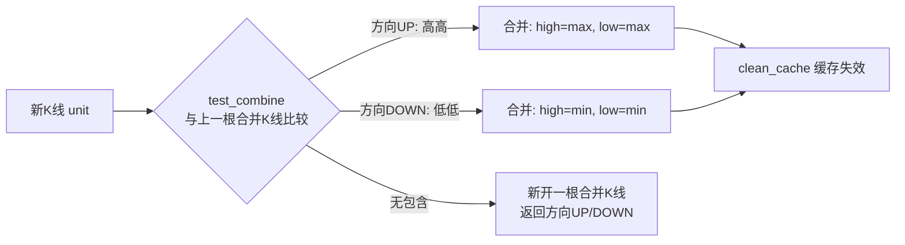
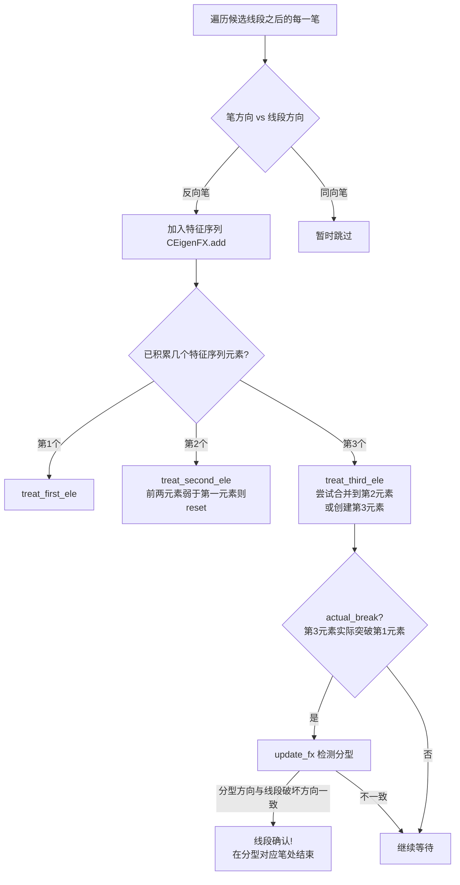
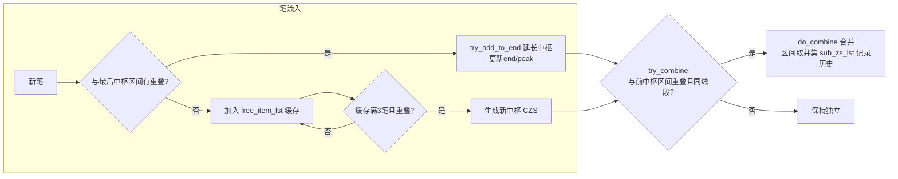
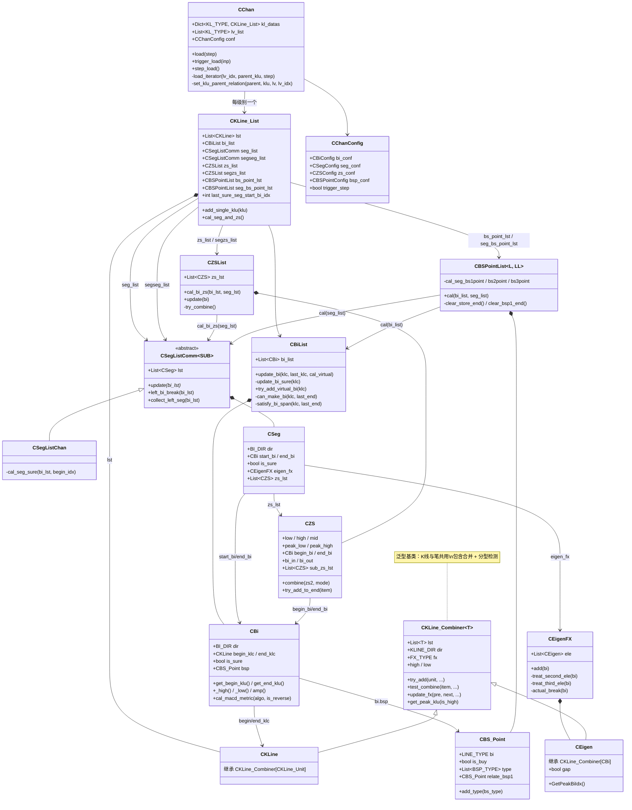
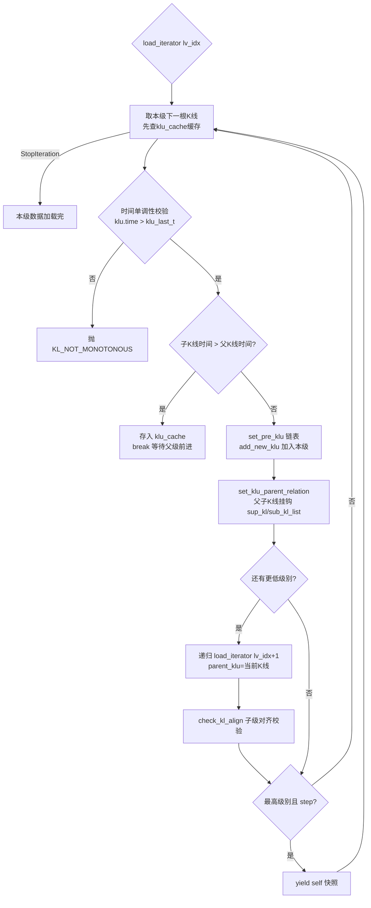
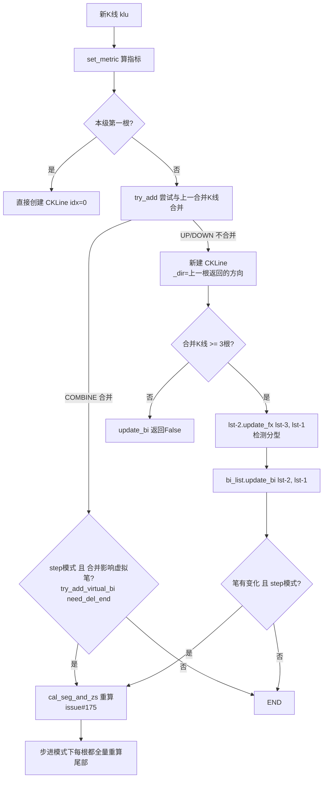
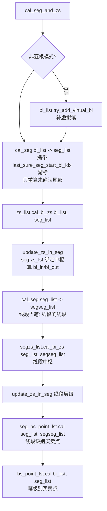
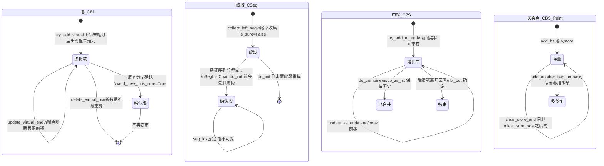
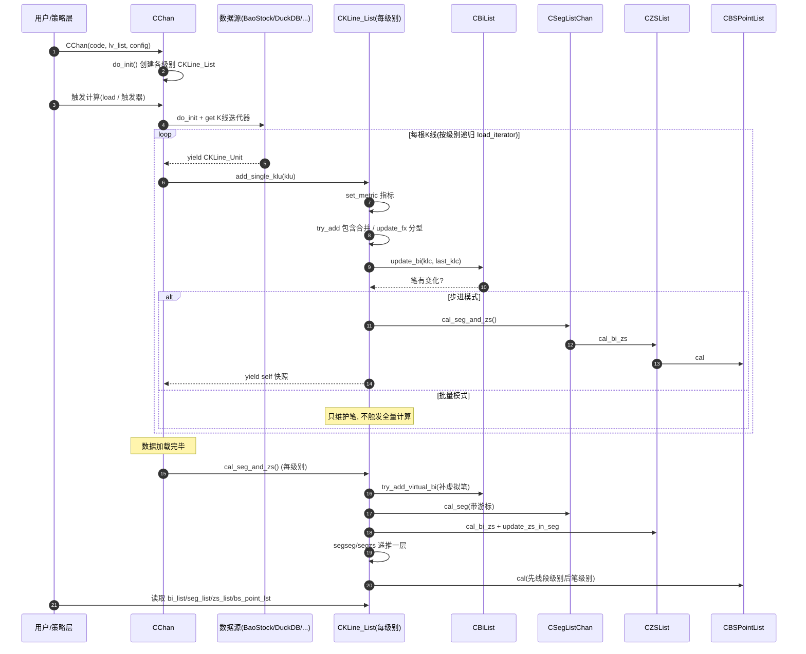

# 缠论策略实现解读

> 本文档解读 `ChanAnalyse/` 中缠论计算内核的**理论内容与代码实现**，配以 UML 类图、流程图、状态图、时序图。
>
> **维护约定**：后续任何对缠论理论实现的变更（笔/线段/中枢/买卖点的算法、规则、配置语义变化），必须**同步修改本文档**对应章节。

---

## 目录

1. [一句话总览](#1-一句话总览)
2. [计算流水线全景图](#2-计算流水线全景图)
3. [核心概念逐个解读](#3-核心概念逐个解读)
   - 3.1 K 线包含处理（合并 K 线）
   - 3.2 分型（顶分型 / 底分型）
   - 3.3 笔
   - 3.4 线段（特征序列法）
   - 3.5 中枢
   - 3.6 买卖点
   - 3.7 背驰与指标
4. [UML 类图](#4-uml-类图)
5. [数据加载流程（多级别递归）](#5-数据加载流程多级别递归)
6. [单根 K 线处理流程](#6-单根-k-线处理流程)
7. [cal_seg_and_zs：从笔到买卖点的计算顺序](#7-cal_seg_and_zs从笔到买卖点的计算顺序)
8. [状态图：确认与虚拟元素](#8-状态图确认与虚拟元素)
9. [时序图：批量模式主流程](#9-时序图批量模式主流程)
10. [两种运行模式](#10-两种运行模式)
11. [配置系统](#11-配置系统)
12. [关键实现细节备忘](#12-关键实现细节备忘)

---

## 1. 一句话总览

系统把一串原始 K 线，按「**合并 → 分型 → 笔 → 线段 → 中枢 → 买卖点**」的顺序逐层抽象：

```
原始K线 ──包含处理──> 合并K线 ──分型检测──> 顶/底分型 ──成笔──> 笔 ──特征序列──> 线段
                                                                    │
                                                                    v
              买卖点 <── 背驰判断 <── 中枢(由至少3笔重叠区间构成) <──+
```

每往上一层，元素数量变少、语义变重：几根 K 线合成一根合并 K 线，几个分型合成一笔，几笔合成一段，几段重叠构成中枢，中枢背驰产生买卖点。买卖点是最终输出，也是策略层（WebAPI / 前端 / 回测）消费的唯一结论。

## 2. 计算流水线全景图

```mermaid
flowchart TD
    A[数据源 DataAPI\nBaoStock/Akshare/CCXT/CSV/DuckDB/Minute] -->|逐根 yield CKLine_Unit| B[CChan.load_iterator\n多级别递归加载]
    B --> C[CKLine_List.add_single_klu\n逐根K线处理]
    C --> C1[指标计算\nMACD/BOLL/RSI/KDJ/DeMark]
    C1 --> C2[CKLine_Combiner.try_add\n包含关系合并]
    C2 -->|不合并| C3[CKLine.update_fx\n分型检测]
    C3 --> C4[CBiList.update_bi\n笔更新]
    C4 -->|笔有变化| D[cal_seg_and_zs]
    C2 -->|合并且影响虚拟笔| D
    D --> D1[CSegListChan.update\n线段: 特征序列分形]
    D1 --> D2[CZSList.cal_bi_zs\n中枢构建]
    D2 --> D3[update_zs_in_seg\n中枢-线段关联]
    D3 --> D4[线段的线段 segseg\n+ 线段中枢 segzs]
    D4 --> D5[CBSPointList.cal\n买卖点计算]
    D5 --> E[结果访问\nchan&#91;KL_TYPE&#93;.bi_list / seg_list / zs_list / bs_point_lst]
```



关键点：**前面所有步骤都是增量可重算的**——`cal_seg_and_zs` 用 `last_sure_seg_start_bi_idx` 等游标只重算「未确认的尾部」，确认过的前缀不动，这是步进模式和增量续算的根基。

## 3. 核心概念逐个解读

### 3.1 K 线包含处理（合并 K 线）

**理论**：缠论要求相邻 K 线之间不能存在包含关系（一根的高低点完全覆盖另一根），否则分型无法唯一定义。处理办法是把有包含关系的 K 线**合并成一根**。

**代码**（[KLine_Combiner.py](../ChanAnalyse/Combiner/KLine_Combiner.py) 的 `try_add` / `test_combine`）：



- 上升趋势（`dir==UP`）：合并取「高高」——高点取两者最大，低点也取两者最大（向上抬）。
- 下降趋势（`dir==DOWN`）：合并取「低低」——高点取最小，低点取最小（向下压）。
- 合并后的 K 线（`CKLine`，即 `CKLine_Combiner` 实例）持有原始 K 线列表 `lst`，并缓存 high/low；每次合并后 `clean_cache()` 让派生属性重算。
- 一字 K 线（high==low）不改变高低点，避免一字板污染合并方向。

### 3.2 分型（顶分型 / 底分型）

**理论**：三根（合并后）K 线，中间那根高点最高、低点也最高 → **顶分型**；中间低点最低、高点也最低 → **底分型**。顶分型预示向上动能衰竭，底分型反之。

**代码**（`CKLine_Combiner.update_fx`，由 [KLine_List.py](../ChanAnalyse/KLine/KLine_List.py) `add_single_klu` 在新合并 K 线产生后调用 `lst[-2].update_fx(lst[-3], lst[-1])`）：

```
顶分型: pre.high < self.high  且  next.high < self.high
        pre.low  < self.low   且  next.low  < self.low
底分型: 全部反向
```

注意 `update_fx` 有两套判断：普通 K 线分型（上述四条件严格版），和 `exclude_included=True` 的**特征序列分型**（用于虚段，条件略宽，配合 `allow_top_equal` 处理相等边界）。

### 3.3 笔

**理论**：相邻的顶分型与底分型连成一笔。笔必须满足最小长度（通常顶底间至少 5 根 K 线 / 3 根合并 K 线）且分型有效（不能共用 K 线等）。笔是缠论最基本的走势单元，后续一切结构都建立在笔上。

**代码**（[BiList.py](../ChanAnalyse/Bi/BiList.py) `CBiList.update_bi` → `update_bi_sure` / `try_add_virtual_bi`）：

- `can_make_bi` 检查三个条件：K 线跨度（`satisfy_bi_span`，bi_algo='fx' 时跳过）、分型有效性（`check_fx_valid`，分型间不能重叠共用）、端点是极值（`bi_end_is_peak`）。
- 笔的方向由起始分型决定（[Bi.py](../ChanAnalyse/Bi/Bi.py) `set`）：底分型开头 → 上升笔，顶分型开头 → 下降笔。
- **第一笔**特殊（`try_create_first_bi`）：之前没有确定分型，用 `free_klc_lst` 缓存历史分型 K 线，直到出现反向分型且满足成笔条件。
- **虚拟笔**（`try_add_virtual_bi`）：最后一笔往往还没走完——末端分型已出现但反向笔未确认。系统先挂一条"虚拟笔"参与后续计算（线段/中枢/买卖点都能用它），等真正确认后再转正或重算。批量模式在全部 K 线加载完后补一次虚拟笔。
- **次高点/次低点优化**（`can_update_peak` / `update_peak`）：笔端点不是精确极值时允许用次高点替换，前提是不使笔方向反转、不使前后笔重叠。

### 3.4 线段（特征序列法）

**理论**：线段由至少 3 笔构成，且被反向线段破坏才算结束。判断线段结束的标准工具是**特征序列**：上升线段中所有**下降笔**视为"K 线"组成特征序列；特征序列出现**顶分型** → 线段被破坏，线段在该分型处结束。

**代码**（[SegListChan.py](../ChanAnalyse/Seg/SegListChan.py) `cal_seg_sure` + [EigenFX.py](../ChanAnalyse/Seg/EigenFX.py) `CEigenFX` + [Eigen.py](../ChanAnalyse/Seg/Eigen.py) `CEigen`）：



- `CEigen` 继承 `CKLine_Combiner[CBi]`——**把笔当 K 线做包含合并**，合并规则与 K 线完全相同（这是缠论"递归自相似"的直接体现）。
- **跳空缺口**（`CEigen.gap`）：特征序列分型第 1、2 元素间有跳空 → 属于线段破坏第二种情况，需等待反向特征序列再确认。
- 分型对应结束笔：`GetPeakBiIdx` 返回 `峰值笔.idx - 1`（分型前一笔才是线段结束笔）。
- 尾部未确认部分由 `collect_left_seg` 收成**虚段**（`is_sure=False`），左段处理方法 `left_seg_method=peak` 时找极值点作第一条线段。
- 三种算法均继承 `CSegListComm`：`chan`（默认，特征序列法）、`1+1`（SegListDYH，已弃用）、`break`（SegListDef，已弃用）。

### 3.5 中枢

**理论**：中枢是至少 3 笔（段）的价格重叠区间，代表多空拉锯的"价值区域"。中枢区间 `[low, high] = [max(各笔低点), min(各笔高点)]`，只有重叠才存在。中枢的进入笔（bi_in）、离开笔（bi_out）、极值（peak_high/peak_low）是买卖点判断的关键锚点。

**代码**（[ZS.py](../ChanAnalyse/ZS/ZS.py) `CZS` + [ZSList.py](../ChanAnalyse/ZS/ZSList.py) `CZSList.cal_bi_zs`）：



- 三种 `zs_algo`：`normal`（按线段切分，每段内找中枢）、`over_seg`（跨线段）、`auto`（确认段用 normal、未确认尾部用 over_seg）。
- 中枢合并条件（`combine`）：不能是一笔中枢、必须在同一线段内、区间按 `zs_combine_mode`（`zs` 看中枢区间 / `peak` 看极值区间）有重叠。
- 中枢与线段互相绑定：`update_zs_in_seg` 把中枢挂到所属线段（`seg.zs_lst`），并计算 bi_in/bi_out。
- **同一套 CZSList/CZS 同时用于两个层级**：笔中枢（`zs_list`，由笔构成）和线段中枢（`segzs_list`，由线段当"笔"构成）——又是递归复用。

### 3.6 买卖点

**理论**：缠论的买卖点体系建立在"中枢 + 背驰"之上。系统实现 6 类（买卖对称）：

| 类型 | 名称 | 通俗解释 | 代码锚点 |
|------|------|----------|----------|
| **T1** | 第一类买卖点 | 趋势背驰点：离开中枢的笔比进入笔力度弱（背驰），趋势衰竭，反转 | `cal_seg_bs1point` |
| **T1P** | 盘整背驰点 | 无中枢（或单中枢盘整）情况下的背驰点；**另含「趋势前提不达标但背驰实证成立」的降级点**（`bsp1_downgrade_reason` 区分成因） | `cal_seg_bs1point` / `treat_bsp1` |
| **T2** | 第二类买卖点 | 一买后回调不创新低（回测不破），确认反转 | `cal_seg_bs2point` |
| **T2S** | 类二买卖点 | 中枢内的多次回测，二买的"次级"版本 | `cal_seg_bs2point` |
| **T3A** | 第三类买卖点(后) | 突破中枢后的回抽不回到中枢内 → 趋势延续 | `treat_bsp3_after` |
| **T3B** | 第三类买卖点(前) | 中枢在当前线段内，离开笔突破后第一次回抽不回到中枢 | `treat_bsp3_before` |

**标准口径（`bsp_preset="standard"`，默认）下各类的完整判据**：

| 类型 | 完整判据 |
|---|---|
| T1 | 结构（有非一笔中枢 + 离开笔突破）× 力度背驰 × `bs1_peak` 极值（**宽松**：相等极值也算创新低/新高）× **趋势前提** × **创趋势新低**（**宽松**）× **DIF 背驰** × **零轴回抽** |
| T2 | 已成立的一买 + 锚点后第 1 笔反向（回调）+ 振幅比 ≤ `max_bs2_rate`（该约束在数学上同时保证「不破一买极值」） |
| T2S | 二买之后的同向笔 + 相邻回抽区间重叠 + 未破参照点 + 回撤率 **(amp 口径)** + **末端价格落在多笔中枢区间内** +（可选）跟随成立的二买 |
| T3A | 下一条线段内的多笔中枢 + 离开笔**方向正确且真正突破** + 其后第一笔反向回抽不回中枢 +（可选）突破笔极值 |
| T3B | 当前线段内最后一个多笔中枢 + 离开笔**方向正确且真正突破** + 其后**第一笔**反向回抽不回中枢（遇回中枢即终止，不后延） |

**T1P 的两类来源**（此前只有第一类）：

1. **无结构中枢的笔背驰**（`treat_pz_bsp1`）：最后两笔同段同向、创极值、力度背驰；
   力度口径与 T1 的 `bsp1_force_scope` 同构（见下「T1P 力度口径走势段化」）；
   标准档下因 `bsp1_zs_extend_to_seg_end=False` 导致此类路径几乎为 0。
2. **降级点**（`treat_bsp1`，`bsp1_downgrade_to_pz=True`）：有结构中枢、力度背驰**实证**成立、
   极值成立、其余标准判据全过，**仅趋势前提不达标**。以 T1P 登记但**不作一买锚点**——
   不写入 `bsp1_sure_dict`，因此不派生二买/三买。
   两条不触发的情形：`bsp1_trend=False`（无趋势要求即无「趋势不达标」）、
   `divergence_rate>100`（背驰判据被关闭，`is_divergence` 的 True 是空真，不算实证）。

四类加粗判据在 `bsp_preset="legacy"` 下全部关闭，逐笔复现改造前输出。

**极值判据的比较口径**（`chan-bsp1-loose-extreme`）：

T1 的两条极值判据——`bs1_peak`（离开笔是否比中枢内部笔更极端）与
`bsp1_new_extreme`（是否创趋势新低/新高）——统一为**宽松**口径：价格**等于**
前面的极值也算「创新低/新高」，双底、双顶不会被拦下。

该口径已固化，**不再作为用户配置项**暴露：原 `bs1_peak_strict` 开关已删除，
`standard` / `legacy` 两档一致走宽松（`BSPointConfig` 内部的 `bs1_peak_strict`
字段仅为兼容存量快照保留，默认 `False`，不进入配置面板与指纹键清单）。

`bsp1_new_extreme_mode` 决定新低的比较范围：

| 取值 | 比较范围 |
|---|---|
| `trend_start`（默认） | 第一个趋势中枢的进入要素起，覆盖完整趋势 |
| `prev_zs_in` | 只与最后一个趋势中枢的进入要素比（仅 b 段） |
| `all` | 该线段内全部同向要素 |
| `level` | 该要素之前的**全量**同向要素（跨线段，不受线段边界限制） |

`level` 是显式收紧选项，用于「把上一轮价格周期的极值也纳入比较」的场景；
未提供全量要素列表时它会退回 `all`，并在 feature 的 `new_extreme_mode_effective`
标明实际口径（不静默降级）。默认 `trend_start` 不变，`level` 为纯增量。

**T1P 力度口径走势段化**（`chan-bsp-ladder-change` D4）：

`treat_pz_bsp1` 的背驰比较原先严格是「前前笔 vs 末笔」的单笔对单笔，与 T1 已完成的
走势段口径（§4.4 修复）不一致。现改为复用同一个 `bsp1_force_scope` 开关：

| 档位 | b 段（进入段） | c 段（离开段） |
|---|---|---|
| `swing`（默认） | 倒数第二个**同向笔组** | 末组同向笔（含末笔） |
| `bi`（legacy 展开） | 前前笔 | 末笔（改造前行为） |

有结构中枢时 T1 用「中枢」分隔 b/c；本路径无中枢，分隔物换成**反向笔组**——
线段内同向笔被反向笔天然分组，末组为 c、倒数第二组为 b。仅一组时（线段内无反向笔）
退回单笔。成交量/换手率类算法无区间版本，自动退单笔并在 feature 标注
`bsp1_force_scope_effective="bi_fallback"`。

> **该窗口在所有级别上都恒为单笔（务必知悉）**：笔与线段的方向都严格交替，
> 「向前收集连续同向笔」循环第一步就不成立，`swing` 与 `bi` 两档因此
> **在 `macd_algo="full_area"` 下取值完全相同**——49 只日线的 308 个无中枢路径
> 候选（笔级别 + 线段级别；41 只池上曾测得 262 次调用）**全部**是 `b=1, c=1`。
> `peak` 口径下曾观察到的 30 个
> 差异点并非窗口聚合生效，而是 `CBi.Cal_MACD_peak()` 不传 `begin_idx`/`end_idx`
> （用整条 `klc_lst`），边界那根合并 K 线里属于邻笔的 klu 漏了进来——边界过滤不一致。
>
> 结论：`chan-bsp-ladder-change` D4 的「反向笔组分隔」在笔/线段这两个级别的实现里
> **是空操作**，`bsp1_force_scope` 实际只影响 **T1**（窗口由中枢边界切出，可含 1/3/5/7 笔，
> 粒度是「一段连续笔」而非「同向笔组」）。要让 T1P 真正走势段化，需要把 c 段改成
> 「末笔所属的、由反向笔分隔的**区间**」而非「连续同向笔」——这属于新增设计，
> 不在本变更范围。`Debug/bsp_standard_equivalence.py` 第 10 节按算法分别断言退化事实。


**术语统一**：文档与注释中的「面积背驰」统一改称「**力度背驰**」——实际力度算法
由 `macd_algo` 配置决定（默认 `full_area` 整段柱体面积，见 §3.7），旧称与实现不符。

**代码**（[BSPointList.py](../ChanAnalyse/BuySellPoint/BSPointList.py) `CBSPointList.cal`）：

- 计算顺序：清理失效尾部 → T1/T1P → T2/T2S → T3A/T3B → 更新 `last_sure_pos` 游标。
- 判据实现集中在层级无关的纯函数模块 [BSPJudgement.py](../ChanAnalyse/BuySellPoint/BSPJudgement.py)，笔级别与线段级别共用同一份逻辑。
- 一个位置可同时是多种类型（`CBS_Point.add_type`，如同时 T1+T1P）。`add_type` 幂等
  （同类型只登记一次）——步进模式下未确认线段会被反复重算，不去重会让 `type` 累积成
  `[T3B, T3B, ...]`，把按 `type` 遍历的统计放大数十倍。`CBS_Point.primary_type`
  按固定优先序（`T1 > T1P > T2 > T3A > T3B > T2S`）给出确定性主类型，供 `bsp_index` 按笔去重。
- 一买分两层：`bsp1_list` / `bsp1_dict` 是**结构性候选**（含未成立），
  `bsp1_sure_list` / `bsp1_sure_dict` 只含**已成立**点。二买/三买的跟随校验与
  `relate_bsp1` 取值都使用成立口径。
- 区间套特征（`bsp1_qjt`，默认关）在 `cal` 收尾后置注解：对 `bsp1_list` 每个点取 c 走势段
  映射到次级别，查次级别 `bsp1_sure_list` 中同向已确认的一买，写 `bsp1_qjt_hit` /
  `bsp1_qjt_sub_idx`。**特征不改成立性**——注解执行时判定链路已结束。
- 跟随关系可配：`bsp2_follow_1`（二买必须跟在一买后）、`bsp3_follow_1`（三买必须跟在一买后，
  可配 `bsp3_follow_1_mode`）、`bsp2s_follow_2`（类二必须跟在成立的二买后）。
- 三买成立的核心判据（`bsp3_back2zs` / `check_zs_peak_on_breakout`）：回抽笔不回到中枢区间内、
  且（`bsp3_peak` 开启时）**突破笔**是否突破中枢内部极值。
- **两个层级与「次级别走势类型」**：
  - `bs_point_lst`（笔级别）：本级别 = 线段，次级别 = **笔**。回抽恒为单笔，
    是**地址化简化口径**，不能直接当作「次级别走势类型」。
  - `seg_bs_point_lst`（线段级别）：本级别 = 线段的线段（`segseg_list`），次级别 = **线段**。
    线段天然具备内部结构（含中枢），**「次级别走势类型」的严格语义由这一层承担**。
  - 绘图时线段级别加 `※` 前缀。
  - 两个层级使用同一套判据函数、同一套力度算法（线段级别此前只支持 `slope`/`amp`，现已补齐）。
- 买卖点计算完会反向挂到笔上（`bi.bsp = self`），下游通过 `bsp_iter()` 遍历。

**T2/T2S 五轴确认阶梯**（`chan-standard-bsp2-change`；判据链不变，五轴为证据标注）：

未确认的 T2/T2S 候选点携带五轴独立证据（轴顺序固定：进度 → 佐证 → 确认 → 分型 →
时间，如 `P2|S3|C2|K3|T1`），已确认点为 `L4` 单值（全类型语义不变）。第三类家族
（T3A/T3B）见下「T3 四轴确认阶梯」。语法独立于 T1 的 L 编号，靠 bsp_type 路由：

| 轴 | 取值 | 语义 |
|---|---|---|
| **进度轴** | `P1` / `P2` | 判据链 ①锚点一买成立 ②回调笔存在 ③不破一买极值（恒过）④回撤率 ≤ 阈值 ⑤可选中枢关联的短路位置：已过 ≤3 项 → `P1`，>3 项或全过未确认 → `P2` |
| **佐证轴** | `S3` / `S2` / `S1` | 回调笔窗口映射的子级别结构证据：`S3` 子级已确认同向点 / `S2` 子级候选（进度第一档）/ `S1` 子级末端同向分型；无子级数据时轴缺席 |
| **确认轴** | `C3` / `C2` / `C1` / `C0` | 事后价格确认（窗口 = `bsp2_confirm_window` 笔）：`C3` 后续笔突破 `break_bi` 端点 / `C2` 收复振幅一半 / `C1` 窗口走完未动（终态降级，不撤销行）/ `C0` 窗口不足（进行中） |
| **分型轴** | `K3` / `K2` / `K1` | 回调笔末端分型强弱（实体口径，与 T1 分型轴同源分级），不反向影响成立性 |
| **时间轴** | `T3` / `T2` / `T1` | 回调速度比 `v = (amp(bsp2_bi)/amp(break_bi)) / (klu_cnt(bsp2_bi)/klu_cnt(break_bi))` 三档：`v ≤ 0.5` 急涨缓跌（衰竭）→ `T3`；`0.5 < v ≤ 1.0` → `T2`；`v > 1.0` 缓涨急跌 → `T1` |

五轴**独立**且全部为证据标注——**不改变 T2/T2S 的成立判据**（判据链内容、顺序与
阈值口径零改动），标注缺失时轴缺席而非候选点消失。量能与 ML 打分显式排除在候选
判断之外。翻转语义：确认轴单向终态（窗口内 C0→C3 合法翻转、窗口走完 C1 终态不
变、终态不撤销行），时间轴/分型轴双向翻转，`L4` 不再参与翻转。推导在 WebAPI 层
（`WebAPI/bsp2_ladder.py` / `bsp2_confirm.py` / `bsp2_time_axis.py` /
`bsp2_progress.py`，纯函数模块，双链路共用），**不改动 CChan 的计算逻辑**。

**T3A/T3B 四轴确认阶梯**（`chan-standard-bsp3-change`；判据链不变，四轴为证据标注）：

未确认的 T3A/T3B 候选点携带四轴独立证据（轴顺序固定：佐证 → 确认 → 分型 → 时间，
如 `S1|C3|K3|T2`），已确认点为 `L4` 单值。**无进度轴**——T3 判据链
（锚定中枢 → 突破方向 → 第一次回抽 → 不回中枢）在回抽笔端点一次性全部可判，
成立即全链通过，不存在「推进到一半」的中间态（与 T2 可步进的判据链不同）。
轴字母与 T2 相同，靠 bsp_type 路由区分，语义随判据对象切换：

| 轴 | 取值 | 语义 |
|---|---|---|
| **佐证轴** | `S3` / `S2` / `S1` | **回抽笔**窗口（单笔区间）映射的子级别结构证据：`S3` 子级已确认同向点 / `S2` 子级候选 / `S1` 子级末端同向分型；无子级数据时轴缺席 |
| **确认轴** | `C3` / `C2` / `C1` / `C0` | 缠论要素 E（回抽后趋势延续）的事后落地（窗口 = `bsp3_confirm_window` 笔）：`C3` 后续笔突破**回抽笔**端点 / `C2` 收复回抽幅度一半 / `C1` 跌回**登记时锚定的中枢区间**（证伪终态，行保留不撤销）/ `C0` 窗口不足（进行中） |
| **分型轴** | `K3` / `K2` / `K1` | **回抽笔末端**分型强弱（实体口径，与 T1/T2 同源分级），不反向影响成立性 |
| **时间轴** | `T3` / `T2` / `T1` | 回抽速度比 `v = (amp(回抽笔)/amp(突破笔)) / (klu_cnt(回抽笔)/klu_cnt(突破笔))` 三档：`v ≤ bsp3_time_axis_strong` 回抽衰竭 → `T3`；中间 → `T2`；`v > bsp3_time_axis_weak` 回抽急促 → `T1`。**参照笔是突破笔**（`bi_list[bsp.bi.idx-1]`），与 T2 的 `break_bi` 取值不同 |

**要素 E 为何不做成成立判据**：E 需要未来 N 根笔才能判定，做成判据会使信号整体
后移 1~2 笔（等于永远买在确认笔的高位，引入未来函数），且与缠论把 E 视作「持有期
走势确认」的语义不符。故 E 只落在确认轴：三买照常在**回抽笔端点**输出（进场点位
不变），之后跌回中枢的标 `C1` 假三买供绩效分组。锚定中枢的区间在登记时快照进
`bsp3_zs_low` / `bsp3_zs_high` 两个只读 feature——不能拿「线段最后一个中枢」判证伪，
两者不等价。

四轴**独立**且全部为证据标注——**不改变 T3A/T3B 的成立判据**（判据链内容、顺序与
阈值口径零改动），标注缺失时轴缺席而非候选点消失。翻转语义：确认轴单向终态
（窗口内 C0→C3 合法翻转、窗口走完 C1 终态不变、终态不撤销行），佐证/分型/时间轴
双向翻转，`L4` 不再参与翻转。终态单向性由窗口封顶（窗口外数据不进输入）保证，
重算结果恒定。推导在 WebAPI 层（`WebAPI/bsp3_ladder.py` / `bsp3_confirm.py` /
`bsp3_time_axis.py`，纯函数模块，双链路共用），**不改动 CChan 的计算逻辑**。

已知限制：标准档下 41 只日线（QFQ，2019 起）仅 1 个 T3 成立点
（`sz.000027` 2023-12-15 三卖，阶梯 `S1|C3|K3|T2`），确认窗口与时间轴阈值尚不足以
定标。回刷脚本按 DuckDB 实际存在的周期枚举键，已覆盖日/周/月/分钟级；HFQ 口径的
11 条因 DuckDB 无 HFQ 原始 K 线无法重算。ST 标的的存量 T3 行按 `exclude-st-stocks`
的「存量保留」要求不删除，但读侧（`bsp_store` 查询、策略引擎 `bsp_reader`、
`monitor_store` 监控回查）统一按 `ST_EXCLUDE_SQL` 过滤，不对外展示也不参与策略判定。
佐证轴依赖子级别数据，单级别复算时该轴缺席——组合串不以 `S` 开头同样合法。
`bsp3_confirm_window` / `bsp3_confirm_level` / `bsp3_time_axis_strong` /
`bsp3_time_axis_weak` 改动会触发配置指纹变化与全量重刷。

**代码**（[BSPointList.py](../ChanAnalyse/BuySellPoint/BSPointList.py) `CBSPointList.cal`）：

### 3.7 背驰与指标

**理论**：背驰 = 价格创新高/新低，但动能（指标）没有同步创新高/新低。判断"笔的力度"是第一类买卖点的核心。

**代码**（[Bi.py](../ChanAnalyse/Bi/Bi.py)、[Seg.py](../ChanAnalyse/Seg/Seg.py) 的 `cal_macd_metric`，
[Math/Metric.py](../ChanAnalyse/Math/Metric.py) 共享实现，[BSPointConfig.py](../ChanAnalyse/BuySellPoint/BSPointConfig.py) `divergence_rate`）：

`macd_algo` 支持 13 种力度算法：**`full_area`（整段柱体面积，默认）**、`peak`（柱峰值，
`legacy` 档口径）、`area`（MACD 半面积）、
`diff`（柱体 `max - min`）、**`diff_peak`（DIF 黄白线极值）**、
`slope`（斜率）、`amp`（振幅）、`amount`/`volumn`（成交额/量）、`*_avg`（均值版）、
`turnrate_avg`（换手率）、`rsi`。

**可多选（AND 语义）**：`macd_algo` 传列表时，要求列表内的指标**全部**判定背驰
才算背驰（`CZS.is_divergence` 逐指标计算后取「与」，返回各指标中最大的背驰率）。
配置面板对应项为「是否背驰的技术指标」，多选控件，至少保留一项。
单值形态下 `macd_algo` 仍是单个枚举，多选时为枚举列表；内部统一用 `macd_algos`。
量能类算法（`amount*` / `volumn*` / `turnrate_avg`）不支持走势段区间，
在多选组合里会单独退化到单笔口径（feature 标 `bsp1_force_scope_effective="bi_fallback"`）；
`rsi` 会自动派生 `cal_rsi=True`。

> 默认值由 `peak` 改为 `full_area` 的理由（`chan-bsp1-extreme`）：单根峰值对「急跌赶底」
> 形态钝感——跌幅大、时间短的 c 段单根柱子天然更深，即使整段动能已衰竭也会被判为
> 不背驰。整段面积与「b/c 两段动能对比」的缠论语义直接对应。41 只日线横评 T1 由 13
> 增至 17，六个变动点经事后价格验证全部为改善。`bsp_preset="legacy"` 显式锁定 `peak`。
> （49 只、水位 2026-11-06 的当前读数：`standard` 档 T1 = 23、`legacy` = 323，
> 见《文档/一买一卖差异点说明.md》§三。）

> 注意：`diff` 与 `diff_peak` 不是同一件事。`diff` 算的是 MACD **柱体**的波动幅度，
> `diff_peak` 算的是 **DIF 线**本身的极值。缠论原文的「黄白线背驰」需要后者。

力度算法在 [Math/Metric.py](../ChanAnalyse/Math/Metric.py) 中以「K 线迭代器 + 方向 + 起止边界」
的纯函数形式实现，`CBi` 与 `CSeg` 各自传入自己的 K 线序列。**笔级别与线段级别使用完全相同的算法**。

背驰判定：进入笔力度 × `divergence_rate`（默认 0.9） > 离开笔力度 → 判定背驰成立。

标准一买在力度背驰之外还要求 **DIF 背驰**（离开段 DIF 极值相对进入段不创新低/新高）
与 **零轴回抽**（b、c 两段之间 DIF 曾穿越零轴）。后者在离散数据上实现为
「进入段结束到离开段开始之间 DIF 出现反号」——若要求「穿越后再穿回」，
两段之间往往只有 1 根 K 线，判据会退化为几乎不可判定。

所有指标均为**手写实现**（[Math/](../ChanAnalyse/Math/)：MACD/RSI/BOLL/KDJ/DeMark/TrendLine/TrendModel），不依赖 talib；每根 K 线到来时先 `set_metric` 算好，笔级别计算直接取用。

## 4. UML 类图



结构上的三个"复用技巧"：
1. `CKLine_Combiner` 泛型基类：K 线包含合并与笔（特征序列）包含合并共用一套逻辑。
2. `CSegListComm` 同时实例化两次：笔→线段、线段→线段的线段（segseg）。
3. `CZSList`/`CBSPointList` 同样双实例：笔级别 + 线段级别。

## 5. 数据加载流程（多级别递归）

`CChan.load_iterator`（[Chan.py](../ChanAnalyse/Chan.py)）从最高级别向最低级别递归，用**时间对齐**决定父子归属：



- 默认级别组合 `[K_DAY, K_60M]`（日线+60 分钟），可自定义多级别。
- 父子指针（`sup_kl`/`sub_kl_list`）支撑**区间套**策略：在父级别买卖点处下钻看子级别确认。
- 时间语义：天以下级别 K 线时间戳是**结束时间**（60M 每天第一根是 10:30），天以上是当天日期。

## 6. 单根 K 线处理流程

`CKLine_List.add_single_klu` 是整个系统的**核心入口**（[KLine_List.py](../ChanAnalyse/KLine/KLine_List.py:226)）：



两个触发 `cal_seg_and_zs` 的条件（注释中的"条件A/条件B"）：新笔形成（A）、包含处理扰动了虚拟笔（B，issue#175 修复）。

## 7. cal_seg_and_zs：从笔到买卖点的计算顺序

[cal_seg_and_zs](../ChanAnalyse/KLine/KLine_List.py:186) 定义了严格的依赖顺序（**底层 → 高层**）：



顺序不可颠倒：有线段才能有中枢，有中枢才能有买卖点；线段级别买卖点先算（笔级别的二/三买要引用"是否有一买"等上下文）。

## 8. 状态图：确认与虚拟元素

缠论计算的精髓是「**确认 vs 未确认**」——历史结论不可变，尾部结论可被新数据推翻：



游标机制（增量的关键）：
- `CKLine_List.last_sure_seg_start_bi_idx` — 最后确认线段起始笔索引，段计算只从此重算。
- `CZSList.last_sure_pos / last_seg_idx` — 中枢重算起点。
- `CBSPointList.last_sure_pos / last_sure_seg_idx` — 买卖点重算起点（删尾部失效点）。

## 9. 时序图：批量模式主流程



## 10. 两种运行模式

| | 批量模式 `trigger_step=False` | 步进模式 `trigger_step=True` |
|---|---|---|
| 数据加载 | 一次加载全部 | `CChan` 变生成器，每根 K 线 yield 一个快照 |
| 计算时机 | 全部加载完后 `cal_seg_and_zs` 一次 | 每根 K 线都重算段/中枢/买卖点（尾部增量） |
| 用途 | 日常离线分析、绘图 | 回测、动画播放、增量续算 |
| 入口 | `CChan(...)` 直接算完 | `for snapshot in chan.step_load()` |
| 外部推送 | — | `trigger_load(inp)` 追加新 K 线 `{级别: [klu]}` |

步进模式是 WebAPI 增量续算引擎与策略回测的基底：`trigger_load` 往已加载实例追加数据，`cal_seg_and_zs` 靠游标只重算未确认尾部。`skip_step` 可跳过前 N 步。

## 11. 配置系统

`CChanConfig`（[ChanConfig.py](../ChanAnalyse/ChanConfig.py)）接收字典，组装子配置；`ConfigWithCheck` 包装器**消费 key 并对未知 key 抛异常**（严格校验）。

| 配置组 | 关键参数 | 默认 | 语义 |
|---|---|---|---|
| 笔 | `bi_algo` | `normal` | `normal`=标准笔（跨度和分型校验），`fx`=分型笔（跳过跨度检查） |
| | `bi_strict` | `True` | 严格分型 K 线数校验 |
| | `bi_fx_check` | `strict` | 分型间有效性检查严格度 |
| | `gap_as_kl` | `False` | 跳空缺口算 1 根 K 线（放宽成笔） |
| | `bi_end_is_peak` / `bi_allow_sub_peak` | `True`/`True` | 端点极值校验 / 次高次低点允许 |
| 线段 | `seg_algo` | `chan` | `chan`/`1+1`/`break`（后两者已弃用） |
| | `left_seg_method` | `peak` | 首段无分型可依时的处理（峰值法/均值法） |
| 中枢 | `zs_combine` | `True` | 相邻中枢是否合并 |
| | `zs_combine_mode` | `zs` | `zs` 按区间重叠 / `peak` 按极值重叠 |
| | `one_bi_zs` | `False` | 允许一笔中枢 |
| | `zs_algo` | `normal` | `normal`/`over_seg`/`auto` |
| 买卖点 | `bsp_preset` | `standard` | 档位预设：`standard`（标准缠论口径）/ `legacy`（改造前行为，逐笔复现） |
| | `divergence_rate` | 0.9 | 背驰判定阈值（进入笔力度×rate vs 离开笔力度）；`legacy` 档为 `inf` |
| | `min_zs_cnt` | 2 | 一买要求的最少中枢数（纯计数，不判方向；上限 2，`bsp1_trend=True` 时取值失效）；`legacy` 档为 1 |
| | `bs_type`(买/卖) | `"1,1p,2,2s,3a,3b"` | 目标买卖点类型集 |
| | `macd_algo` | `full_area` | 力度算法，**可多选**（列表时要求所选指标**同时**判定背驰）；13 种取值，`diff_peak` 为 DIF 极值 |
| | `bsp1_trend` / `bsp1_new_extreme` / `bsp1_dif_div` / `bsp1_zero_axis` | `True`×4 | 一买四项标准判据（趋势、新低、DIF 背驰、零轴回抽） |
| | `bsp1_zs_extend_to_seg_end` | `False` | 是否仍要求中枢延伸到线段末笔（历史自定义过滤，非理论要求） |
| | `bsp2_retrace_zs` | `False` | 二买回调是否须与中枢区间关联 |
| | `bsp2s_require_zs` | `True` | 类二是否须落在多笔中枢区间内 |
| | `bsp2s_rate_mode` | `amp` | 类二回撤率量纲（`amp` 与二买同构 / `disp` 旧口径） |
| | `bsp2_confirm_window` | `2` | T2 五轴确认轴考察窗口笔数（1 或 2；实证定标见《文档/二买确认轴实证报告.md》0.1） |
| | `bsp2_confirm_level` | `strong` | 确认轴阈值口径：`strong` 突破 `break_bi` 端点 / `weak` 收复一半即算确认 |
| | `bsp2_time_axis_strong` / `bsp2_time_axis_weak` | `0.5` / `1.0` | 时间轴速度比分档线（方向假设未获实证支持，阈值待更大样本复验） |
| | `bsp3b_mode` | `standard` | 三买B 判定档位（`standard` / `legacy`） |
| | `bsp3_peak_on_breakout` | `True` | `bsp3_peak` 的判据对象是突破笔（True）还是回抽笔（False） |
| | `bsp3_follow_1_mode` | `sure` | 三买跟随一买的口径（`sure` 成立 / `candidate` 候选） |
| | `bsp1_downgrade_to_pz` | `True` | 趋势不达标但背驰实证成立时降级为 T1P（落库但不作一买锚点） |
| | `bsp1_force_scope` | `swing` | 一买/T1P 力度 b/c 取值窗口：`swing` 走势段（T1：上一中枢后~进入笔 / 离开笔~线段末笔；T1P：倒数第二个同向笔组 / 末组同向笔）/ `bi` 单笔 |
| | `bsp1_qjt` | `False` | 一买区间套特征：写 `bsp1_qjt_hit`/`bsp1_qjt_sub_idx`，**不改成立性** |
| | `bsp1_qjt_depth` | `1` | 区间套链式确认层数（1 = 只看直接次级；>1 需下层容器） |
| | `bsp2_follow_1` 等 | 见配置 | 类型间跟随关系 |
| 模式 | `trigger_step` / `skip_step` | `False`/`0` | 步进模式开关 |
| 指标 | `macd` / `cal_rsi` / `cal_kdj` / `boll_n` / `cal_demark` | — | 指标开关与参数 |
| 校验 | `kl_data_check` / `max_kl_misalgin_cnt` 等 | — | 数据质量校验 |

支持按买卖点类型覆盖：`bs_type-buy`/`bs_type-sell`/`seg-` 等后缀实现同一参数在买/卖/线段级别取不同值。

**档位预设的两层合并**：`bsp_preset` 先展开为一组默认值，再用用户**显式传入**的 key 覆盖。
因此 `{"bsp_preset": "legacy"}` 一键回退旧行为，而
`{"bsp_preset": "legacy", "bsp1_zero_axis": True}` 只让零轴判据生效、其余仍是旧口径。

**这些参数已开放为业务配置**（`chan-config-panel` 起）：K 线页顶栏「缠论参数」按钮打开配置抽屉，
57 项参数（54 常驻 + 3 条件项）全部可改；保存后写入 PG `chan_config` 表并自动触发当前股票重算，抽屉内「同步所有股票」
等价于 `catch_up(force=True)`，可一键重跑全库。详见
[文档/缠论配置参数.md](./缠论配置参数.md) §十四。

配置取值按三层优先级解析：**内核硬编码默认 → 档位预设 `bsp_preset` 展开 → 用户显式改过的项**。
抽屉只把与**当前档位预设基线**不同的项写进 `overrides`（不是与内核默认比 —— 那样会把 legacy 档
预设展开的十余项误判成用户覆盖），内核将来调整默认值时用户没改过的项会自动跟上。

**档位名存 `chan_config.preset` 列，不在 `overrides` 里**（它本来就不是「用户改过的项」），
所以计算出口 `build_conf()` / `effective_config()` 必须把档位回填进传给内核的字典；
漏了这一步 `CChanConfig` 只会看到硬编码默认 `standard`，**切档位一处判据都不跟着变**。
字段落点是 `WebAPI/chan_config_store.py`（读写 + 派生键 + 档位回填 + 校验）、`WebAPI/chan_config_schema.py`
（参数元数据与白话解释）、`WebAPI/routers/chan_config.py`（REST 端点）。

**参数覆盖暗坑仍在**：`CChanConfig` 的取值规则是「默认 → 用户显式 key 覆盖」。
任何调用方只要显式写了 `divergence_rate` / `min_zs_cnt` / `bs1_peak`，就会**静默压过**
档位预设。仓库内的覆盖点已在
[Debug/bsp_standard_equivalence.py](../Debug/bsp_standard_equivalence.py) 模块注释中登记；
`WebAPI/incremental_engine.py` 与 `WebAPI/chan_service.py` 的配置构造统一走
`chan_config_store.build_conf()` 单一出口（避免两个入口用不同配置导致指纹与计算脱节）。

## 12. 关键实现细节备忘

- **实例级缓存**（[Common/cache.py](../ChanAnalyse/Common/cache.py) `@make_cache`）：缓存绑定 `self._memoize_cache`（区别于 `lru_cache` 的全局缓存）。`CBi`/`CKLine_Combiner`/`CZS` 的派生属性（`get_end_klu`/`_high`/`amp` 等）大量使用；**任何状态变更后必须 `clean_cache()`**，否则读到脏值。
- **双向链表**：合并 K 线之间（`pre/next`）、笔之间（`pre/next`）、原始 K 线之间（`pre`）都有链表指针。
- **deepcopy 陷阱**（[Chan.py](../ChanAnalyse/Chan.py)）：`CChan.__deepcopy__` 手动重建跨级别 `sup_kl`/`sub_kl_list` 指针图；`chan_dump_pickle`/`chan_load_pickle` 在 pickle 前摘除 `pre`/`next` 指针防递归溢出（并临时调 `sys.setrecursionlimit`），之后恢复。
- **数据质量校验**：时间单调性（`KL_NOT_MONOTONOUS`）、子级别对齐（`check_kl_align`，允许 `max_kl_misalgin_cnt` 根错位）、高低点一致性（`check_kl_consitent`）。
- **趋势线**（[Math/TrendLine.py](../ChanAnalyse/Math/TrendLine.py)）：支撑线连上升线段相邻笔低点（取最大斜率），阻力线连高点（取最小斜率），用于判断线段内部支撑/压力与突破。
- **绘图元数据**（[Plot/PlotMeta.py](../ChanAnalyse/Plot/PlotMeta.py)）：`CChanPlotMeta` 把计算对象转轻量绘图元数据；线段级别买卖点标记加 `※` 前缀。
- **本仓库边界**：完整版（约 22000 行）的策略、交易引擎、ML/AutoML 模块不在开源版内；`ChanModel/Features.py` 的 `CFeatures` 特征容器是 ML 部分的残留接口。

---

> **再次提醒**：缠论计算逻辑（`CChan`/`CBiList`/`CSegListChan`/`CZSList`/`CBSPointList`）是本仓库所有下游系统（WebAPI、前端、策略任务、监控）共用的唯一内核。任何理论实现变更除修改代码外，**必须同步更新本文档**对应章节与图表。

### 3.8 同一笔上多类型的 `relate_bsp1` 保留策略

一笔可以同时是多种买卖点（如 T3A 与 T3B）。标准化后的三买尤其如此：T3A 依托
「本线段末笔**之前**」的中枢、T3B 依托「本线段**内**」的中枢，两者对应的中枢与
一买可以不同。

此类情形下 `relate_bsp1`（关联的一买）**保留先登记的那一个**（判定顺序
T3A 先于 T3B），不做覆盖。`type` 列表本身仍记录全部类型，下游按
`primary_type` 去重（见 3.6 的 `primary_type` 优先序）。

历史实现在此处有 `assert` 要求两次登记的 `relate_bsp1` 相同，在
`divergence_rate=0.9 + min_zs_cnt=1` 这类单项覆盖下会真实失败并中断整只股票的
线段级别计算。该断言已移除——`relate_bsp1` 在仓库内无下游消费方，
「保留先登记者」对下游无任何影响。
